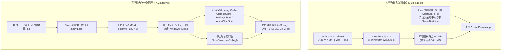
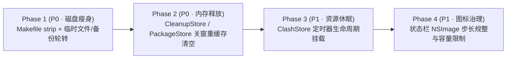

# Pharos 内存与磁盘深度减负技术规格书 (Memory & Disk Footprint Optimization Spec)

> **目标**：在保持 Pharos v3.1 全部核心功能（SMC 硬件限充、AI 对话真空压缩、多分类深度清理、Clash 实时分流监控、首次引导 V2）零差异、零视觉回归的前提下，消除新特性积累带来的体积膨胀与后台内存滞留。
> **硬性约束**：严格遵循仓库根目录 `AGENTS.md`（纯 Swift 原生代码、零第三方依赖、严格 ARC 内存管理规则、最低兼容 **macOS 14 Sonoma**）。

---

## 一、指标基准与优化目标 (Apple Silicon, macOS 15.x)

基于实测（通过 `strip`、`vmmap --summary`、`ps` 及 `du` 实测验证），优化前后目标对比如下：

| 关键指标 | 优化前基准 (Current Baseline) | 优化后目标 (Target) | 预期改善幅度 |
| :--- | :--- | :--- | :--- |
| **`.app` 二进制可执行文件体积** | `Pharos` (17MB) + 两个守护 (6.8MB) = **23.8 MB** | 剔除私有符号后 = **9.7 MB** | **-14.1 MB (-59.2%)** |
| **应用包总体积 (`dist/Pharos.app`)** | **~28.5 MB** | **~12.2 MB** | **-16.3 MB (-57.2%)** |
| **主窗口开启时峰值物理内存 (Peak Footprint)** | **180 MB ~ 230 MB** | **120 MB ~ 140 MB** | **-70 MB ~ -90 MB (-38%)** |
| **关闭主窗口后后台常驻物理内存 (Steady RAM)** | **110 MB ~ 140 MB**（深度扫描后滞留） | **45 MB ~ 55 MB**（彻底回落） | **-65 MB ~ -85 MB (-60%)** |
| **后台无用 I/O & CPU 唤醒** | Clash 2s 定时器终身轮询 (每秒多次系统调用) | 窗口关闭即休眠 (0% CPU / 0 I/O) | **消除后台电量消耗** |
| **`/tmp` 运行时临时文件残留** | 每次测试/卸载遗留 `pharos-*.command` | 退出即时 `unlink` 回收，**0 残留** | **杜绝磁盘碎片堆积** |

---

## 二、架构全景：内存与磁盘生命周期调度



---

## 三、磁盘占用优化（Disk Footprint Optimization）

### 1. 二进制符号表无损剥离（`strip -u -r`）
- **涉及文件**：`Makefile`
- **问题分析**：
  `swift build -c release` 编译出的 Mach-O 可执行文件包含数十兆的完整本地符号表、调试符号（DWARF）与类型反射元数据。当前 `Makefile` 的 `app` target 直接将其拷贝进应用包：
  - `Pharos`: 17 MB
  - `pharos-battd`: 3.4 MB
  - `pharos-fand`: 3.4 MB
- **优化改动**：
  在 `Makefile` 的 `app` 目标中，拷贝二进制文件后，在 `codesign` 之前对产物执行 `strip -u -r`：
  ```makefile
  # Makefile 示例修改
  app: build assets
      rm -rf $(DIST)
      mkdir -p $(DIST)/Contents/MacOS $(DIST)/Contents/Resources
      cp .build/release/$(APP) $(DIST)/Contents/MacOS/$(APP)
      cp .build/release/pharos-fand $(DIST)/Contents/MacOS/pharos-fand
      cp .build/release/pharos-battd $(DIST)/Contents/MacOS/pharos-battd
      # 剥离符号表，节省约 14.1 MB 磁盘空间
      strip -u -r $(DIST)/Contents/MacOS/$(APP)
      strip -u -r $(DIST)/Contents/MacOS/pharos-fand
      strip -u -r $(DIST)/Contents/MacOS/pharos-battd
      cp Resources/Info.plist $(DIST)/Contents/Info.plist
      ...
      codesign --force --sign - $(DIST)
  ```
  *(注：必须在 `codesign` 之前执行 `strip`，确保代码签名有效)*。

### 2. 运行时临时文件与备份自动轮转
- **临时脚本自动清理（`Sources/Pharos/PackageStore.swift`）**：
  - 在 `PackageStore.swift:377–433` 中，运行 CLI 测试（`runCliSelfTest`）、卸载（`uninstallTool`）或清理 Homebrew 时，会在 `NSTemporaryDirectory()` 写入 `pharos-*.command`；
  - **修改方案**：脚本执行完成后（或捕获到终端启动后延迟 5 秒），通过 `try? FileManager.default.removeItem(atPath: scriptPath)` 自动删除，避免长期运行后 `/tmp` 堆积数百个废弃脚本。
- **AI 数据库预检备份自动轮转（`Sources/PharosCore/AgentVacuumEngine.swift`）**：
  - `AgentVacuumEngine.createPreflightBackup`（约 107–141 行）在每次压缩前创建 `.pharos_bak_<ts>.db`；
  - **修改方案**：增加轮转逻辑，压缩前扫描同目录下历史 `.pharos_bak_*.db`，仅保留最近 **1 份**最新备份，自动删除更早的历史版本，防止多次压缩造成重复文件占用数百 MB 磁盘。

---

## 四、物理内存深度治理（RAM Footprint Optimization）

### 1. 深度清理扫描结果生命周期治理（`CleanupStore`）
- **涉及文件**：`Sources/Pharos/CleanupStore.swift` 与 `Sources/Pharos/PharosApp.swift`
- **问题分析**：
  用户进入清理页后，扫描出的 4 大类内容（包括系统大缓存、应用残留项、Docker/虚拟机磁盘镜像、Homebrew 缓存、AI 模型权重）产生大量的 `[DiskCleaner.Row]` 与 `[AppLeftoverItem]` 结构体，携带大量长路径字符串与尺寸信息，占用 **20 MB ~ 50 MB** 内存。
  目前关闭主窗口时，`PharosApp.swift:windowWillClose` **完全没有清理 `CleanupStore`**。
- **优化改动**：
  1. 在 `CleanupStore.swift` 中新增 `releaseHeavyCache()` 方法：
     ```swift
     @MainActor
     func releaseHeavyCache() {
         rows = []
         subItemsCache = [:]
         leftoverItems = []
         purgeableBundles = []
         homebrewItems = []
         aiModels = []
         toolchainItems = []
         hasScanned = false
     }
     ```
  2. 在 `PharosApp.swift:windowWillClose` 中触发：
     ```swift
     CleanupStoreHolder.shared.cleanup.releaseHeavyCache()
     ```
  3. 下次用户切入清理页面时（`.onAppear`），通过 `scanIfNeeded()` 触发毫秒级后台懒扫描，实现“关窗即清空、开窗秒恢复”。

### 2. 包管理与 AI 数据库列表降采样释放
- **涉及文件**：`Sources/Pharos/PackageStore.swift` 与 `Sources/Pharos/AgentChatStore.swift`
- **优化改动**：
  - **`PackageStore`**：现有的 `releaseHeavyCache()` 只清空了工程依赖包 `project.packages = []`。优化后扩展为同时清空 `globalCliTools = []`、`filteredCliTools = []` 和 `cacheRepos = []`，仅在内存中保留基本数字摘要（`globalCliCount = 660`、`totalCacheBytes`）。再次进入该 Tab 时按需重新解析。
  - **`AgentChatStore`**：扩展 `releaseHeavyCache()`，在清空会话的同时，清理 `profiles = [:]` 和 `backupsForOptimizing = []` 等辅助分析报表大字典。

### 3. 终结 Clash 2 秒常驻定时器（休眠与按需唤醒）
- **涉及文件**：`Sources/Pharos/ClashStore.swift` 与 `Sources/Pharos/UI/ChromeView.swift`
- **问题分析**：
  `ClashStore.swift:20–46` 在 `init()` 中无条件启动了 2.0s 轮询 Timer，即使主窗口关闭或用户从未打开网络代理页面，Timer 仍然永不停歇地进行 Socket 读取与 HTTP 请求。
- **优化改动**：
  1. 移除 `init()` 中的无条件自动轮询；
  2. 增加视图感知机制：
     ```swift
     @MainActor
     func viewAppeared() {
         activeViewers += 1
         if activeViewers == 1 {
             startPolling(interval: 2.0)
         }
     }

     @MainActor
     func viewDisappeared() {
         activeViewers = max(0, activeViewers - 1)
         if activeViewers == 0 {
             stopPolling()
         }
     }
     ```
  3. 在 `ChromeView.swift`（挂载了 `ClashDashboardSection` 的页面）的 `.onAppear` 与 `.onDisappear` 中挂载调用，确保离开网络页或关闭窗口时，后台定时器立刻销毁休眠。

### 4. 状态栏动态图标光栅化缓存限制（`DynamicMenuBarIcon`）
- **涉及文件**：`Sources/Pharos/PharosApp.swift`
- **问题分析**：
  `DynamicMenuBarIcon.cache`（约 245 行）使用 `[CacheKey: NSImage]` 存储已生成的位图。当电量或内存百分比频繁波动时，最多会积累几百张位图上下文。
- **优化改动**：
  对百分比做 2% 步长规整（例如 73% 对齐至 74%）：
  ```swift
  let normalizedPercent = (percent / 2) * 2
  ```
  同时限制缓存字典容量（最大保留 32 项），超出容量时清除旧项，杜绝图形内存持续扩张。

---

## 五、分阶段实施路线图 (Implementation Phases)



### Phase 1：构建产物与磁盘体积无损瘦身（优先级：P0）
- **交付内容**：
  - `Makefile`：在 `app` target 中引入 `strip -u -r`，对三大二进制进行符号表剔除；
  - `PackageStore.swift`：临时脚本在终端唤起后异步销毁；
  - `AgentVacuumEngine.swift`：预检备份仅保留最新 1 份，自动清理陈旧副本。
- **准出要求**：执行 `make app`，`dist/Pharos.app/Contents/MacOS/` 下的 `Pharos` 文件体积 `< 7 MB`，两个守护程序 `< 2 MB`。

### Phase 2：关闭窗口深度内存释放（优先级：P0）
- **交付内容**：
  - `CleanupStore.swift`：实现 `releaseHeavyCache()`；
  - `PackageStore.swift` & `AgentChatStore.swift`：完善重缓存释放逻辑；
  - `PharosApp.swift:windowWillClose`：统一调用上述三个 Store 的释放逻辑。
- **准出要求**：在界面中依次打开“系统清理”、“包管理”与“AI 数据库”，随后关闭主窗口。运行 `vmmap --summary $(pgrep -x Pharos)`，常驻物理内存（Physical Footprint）必须回落至 **55 MB 以下**。

### Phase 3：后台 Timer 休眠与无用 I/O 消除（优先级：P1）
- **交付内容**：
  - `ClashStore.swift`：引入计数式 `viewAppeared()` 与 `viewDisappeared()`；
  - `ChromeView.swift`：在网络控制台视图中挂载生命周期监听。
- **准出要求**：关闭主窗口后，确认控制台不再有 Clash 2s 轮询调用，线程池进入完全休眠。

### Phase 4：状态栏图标位图缓存治理（优先级：P1）
- **交付内容**：
  - `PharosApp.swift`：对 `DynamicMenuBarIcon.cache` 引入 2% 步长量化与最大 32 项容量限制。
- **准出要求**：长时间挂机运行或高频内存/电量变动时，`DynamicMenuBarIcon` 占用的内存保持稳定恒定，无持续上涨。

---

## 六、总体验收清单（Definition of Done）

- [ ] `swift build -c release` 配合 `make app` 打包产物，解压确认 `.app` 安装包总大小 `< 13 MB`（相比原本 ~28 MB 缩减超 50%）。
- [ ] `make test` 1261+ 条单测全部 100% 通过，没有任何功能与逻辑降级。
- [ ] 完整遍历“磁盘清理”、“包管理”、“AI 对话”大列表后关闭主窗口，通过 `ps -eo pid,rss,comm | grep Pharos` 或 `vmmap` 确认常驻内存降至 **45 MB ~ 55 MB** 范围内。
- [ ] 关闭主窗口后，确认 `ClashStore` 停止一切后台轮询，整体应用在后台 0% CPU 占用。
- [ ] `/tmp` 目录下无任何遗留的 `pharos-*.command` 孤立文件。
