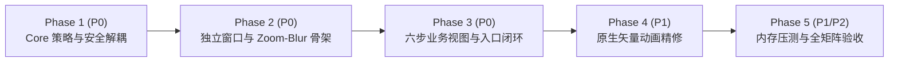

# Pharos 首次启动引导（First Launch Experience / Onboarding）工程实现规格书

> **面向对象**：负责实现首次启动引导功能的开发工程师 / AI Coding Agent  
> **适用系统**：最低兼容 **macOS 14.0 Sonoma**（与 `Package.swift` 一致），主开发与验证环境 **macOS Sequoia 15.6+**（Apple Silicon）  
> **关联守则**：施工前必须同时遵守 [AGENTS.md](../AGENTS.md)、[DESIGN.md](../DESIGN.md)、[BATTERY_CONTROL_SPEC.md](./BATTERY_CONTROL_SPEC.md)、[MEMORY_OPTIMIZATION.md](./MEMORY_OPTIMIZATION.md) 与 [SWIFTUI_GAUSSIAN_MOTION_BLUR_GUIDE.md](./SWIFTUI_GAUSSIAN_MOTION_BLUR_GUIDE.md)。若任何细节存在歧义，以安全边界与零泄漏原则为最高优先级。

---

## 一、目标与硬性红线（施工前必读）

### 1.1 核心目标
为用户提供一套具有 Apple 原生激活助手质感、支持 **Zoom 景深缩放 + 动态高斯运动模糊（Zoom & Motion Blur）** 的 6 步首次启动体验：
1. **认识 Pharos 全景能力**（电源与散热守护、内存与开发端口透视、无痕空间清理，避免用户误以为仅有电池功能）；
2. **理解电源直通原理**（通过交互式沙盒演示 `0 mA` 外接电源直通主板「小插头」状态，明确与真实硬件操作隔离）；
3. **透明按需配置权限**（不虚构权限、不强制阻断、可全部跳过）；
4. **定制核心首日偏好**（草稿态预览，确认后才落盘）；
5. **掌握常驻菜单栏用法**（直接复用真实 Popover 组件预览，零双套 UI 维护成本）；
6. **清晰确认生效状态并进入主界面**（引导窗口彻底销毁，常驻运行期 **0 MB 内存增量**）。

### 1.2 绝对禁止事项（红线）
- **严禁引入任何第三方依赖或外部媒体资产**：禁止添加 Lottie、Rive 等任何 SPM Package；禁止引入 `.mp4` / `.mov` / `.gif` / `.json` 录播动画；禁止引入 `.xcodeproj`。100% 使用纯 Swift + SwiftUI + CoreGraphics 实现。
- **严禁未经用户显式确认修改系统电源/SMC 状态**：在 Step 01–03 以及 Step 04 默认状态下，绝不允许向 `pharos-battd` 发送 `.limit` 指令改写 `CHTE`/`CH0C` 寄存器。
- **严禁对老版本升级用户强弹首次引导**：存量升级用户必须静默识别并直接进入主窗口（可从「设置 → 快捷操作」手动重看引导）。
- **严禁留下后台常驻 GPU 图层或无限空转定时器**：动画静止时 `blur(radius:)` 必须精确归零（`0.0`），`TimelineView` 播放完毕必须 `paused: true`，引导窗口关闭时必须置空 `contentViewController` 释放全部视图与 `IOSurface` 缓冲。
- **严禁在 View 中硬编码任何中英文字符串或颜色字面量**：所有文案走 `Sources/Pharos/UI/L10n.swift`，所有颜色/圆角/字号/间距走 `Sources/Pharos/UI/DesignSystem/`。

---

## 二、工程架构与文件清单

### 2.1 新增文件目录结构

严格遵守「纯逻辑进 `PharosCore` 可单测、协调器与窗口进 `Pharos`、纯界面与动效进 `Pharos/UI/Onboarding`」的分层约定：

```text
Sources/
├── PharosCore/
│   └── OnboardingPolicy.swift                     # 纯值类型与纯函数：首次启动判定、存量用户识别、台式机适配、OnboardingDraft 模型
├── Pharos/
│   ├── OnboardingCoordinator.swift                # @MainActor ObservableObject：步骤路由、方向状态、草稿管理、两阶段安全提交
│   └── OnboardingWindowController.swift           # 独立 720×520 NSWindow 管理，关闭即彻底销毁 NSHostingController
├── Pharos/UI/Onboarding/
│   ├── OnboardingView.swift                       # 顶层容器：顶栏（语言胶囊 + 跳过）+ ZoomBlur 舞台容器 + 底栏（胶囊进度点 + 返回/继续）
│   ├── OnboardingMotion.swift                     # Zoom + 动态模糊 Transition、错峰入场修饰器、低功耗/减弱动态效果自动降级护栏
│   ├── Steps/
│   │   ├── OnboardingWelcomeStepView.swift        # Step 01: Meet Pharos + 雷达光束点阵动态徽标
│   │   ├── OnboardingPowerIntroStepView.swift     # Step 02: 电源直通三态交互演示（台式机自动切换为硬件与环境透视演示）
│   │   ├── OnboardingPermissionsStepView.swift    # Step 03: 最小权限透明清单与实时状态回显
│   │   ├── OnboardingPreferencesStepView.swift    # Step 04: 充电上限草稿、Popover 电池模块开关、菜单栏文字、开机自启
│   │   ├── OnboardingMenuBarStepView.swift        # Step 05: 模拟菜单栏点击 + 嵌入真实 PopoverTabsContent 预览
│   │   └── OnboardingCompletionStepView.swift     # Step 06: 真实生效配置摘要与进入 Pharos
│   └── Animations/
│       ├── RadarBeamLogoCanvas.swift              # 复刻 Scripts/make-icon.swift 几何构图的纯 SwiftUI Canvas 入场扫描动画
│       └── PowerFlowDiagramView.swift             # 适配器 → 主板 / 电芯能量流向矢量动画组件
└── pharos-tests/
    └── OnboardingTests.swift                      # OnboardingPolicy 与 OnboardingDraft 单元测试
```

### 2.2 对现有文件的最小化改动点（仅限以下 6 处）

1. **`Sources/Pharos/BatteryStore.swift`（安全解耦必改）**：
   - 现状隐患：`install()` 在守护进程安装成功后会默认构造 `.limit(maxPercent: targetLimit)` 并立即激活硬件限充。
   - 改造要求：将签名扩展为 `func install(activateLimitAfterInstall: Bool = true, onComplete: (@MainActor (Bool) -> Void)? = nil)`（默认参数保持兼容现有 `BatteryControlView` 行为）。当 Step 03 调用 `install(activateLimitAfterInstall: false)` 时，仅安装并启动 `pharos-battd`，保持 `.system`（macOS 原生托管）模式，绝不写限充寄存器。
2. **`Sources/Pharos/UI/PopoverBlocks.swift`（状态显示修正）**：
   - 在 `PopoverBatteryBlock` 中，显示限充目标百分比 `(targetLimit%)`、`→ targetLimit%` 以及右侧「立即充满」按钮前，必须校验 `battery.isPharosManaging`（即 `helper == .ready && !unsupported && mode != .system`），避免未安装守护或处于系统默认模式时误导用户。
3. **`Sources/Pharos/PharosApp.swift`（启动分流接入）**：
   - 在 `AppDelegate.applicationDidFinishLaunching` 中，替换原先无条件的 `showMainWindow()`：
     ```swift
     if OnboardingCoordinator.shouldPresentOnLaunch() {
         OnboardingWindowController.shared.show(store: store, isReplay: false)
     } else {
         showMainWindow()
     }
     ```
   - 在 `applicationShouldHandleReopen` 中：若 `OnboardingWindowController.shared.isVisible` 为 `true`，将引导窗口置前（`makeKeyAndOrderFront`），否则走原有 `showMainWindow()`。
4. **`Sources/Pharos/UI/SettingsView.swift`（重看引导入口）**：
   - 在 `MainSettingsView` 的「1. Quick Actions（快捷操作）」卡片网格中，新增「重新查看引导 / Replay Onboarding」胶囊按钮，点击调用：
     ```swift
     OnboardingWindowController.shared.show(store: store, isReplay: true)
     ```
   - 在「重置所有设置」逻辑中，**保留** `pharos.onboardingCompletedVersion` 不清空（防止重置偏好后突兀弹出引导）。
5. **`Sources/Pharos/UI/L10n.swift`**：新增引导所需的全部 `zh-Hans` / `en` 双语属性。
6. **`Sources/pharos-tests/main.swift`**：注册并调用 `testOnboarding()`。

---

## 三、首次启动判定与数据安全模型（`OnboardingPolicy.swift`）

### 3.1 持久化键定义
- `pharos.onboardingCompletedVersion`（`Int`，当前版本常量 `currentVersion = 1`）：完成或主动跳过引导后写入 `1`。
- `pharos.onboardingResumeStep`（`Int?`）：仅当用户在 Step 03 点击跳转系统设置授予 Full Disk Access 可能导致 macOS 要求重启应用时写入当前步骤索引；正常完成后清除。

### 3.2 全新安装 vs 存量升级老用户判定（纯函数可单测）

```swift
public enum OnboardingPolicy {
    public static let currentVersion = 1

    /// Legacy keys written by existing Pharos versions before Onboarding existed.
    public static let existingUserTraceKeys: [String] = [
        "popoverLayout.v1",
        "batteryTargetLimit",
        "batteryLimitEnabled",
        "favoriteWorkspaces.v1",
        "chromePresets.v1",
        "refreshSeconds",
        "menuBarText"
    ]

    public enum LaunchDecision: Equatable, Sendable {
        /// Brand-new user (or interrupted FDA restart): show onboarding at given step index.
        case showOnboarding(startStep: Int)
        /// Existing user upgrading from an earlier version: mark migrated silently and open main window.
        case skipForExistingUpgrader
        /// Already completed onboarding.
        case openMainWindow
    }

    public static func evaluateLaunch(
        completedVersion: Int?,
        resumeStep: Int?,
        presentKeys: Set<String>
    ) -> LaunchDecision {
        if let completedVersion, completedVersion >= currentVersion {
            return .openMainWindow
        }
        if let resumeStep, (0..<6).contains(resumeStep) {
            return .showOnboarding(startStep: resumeStep)
        }
        if !presentKeys.isDisjoint(with: existingUserTraceKeys) {
            return .skipForExistingUpgrader
        }
        return .showOnboarding(startStep: 0)
    }
}
```
> **关键行为**：当返回 `.skipForExistingUpgrader` 时，协调器静默写入 `pharos.onboardingCompletedVersion = 1` 并直接打开主窗口，绝不打扰老用户。

### 3.3 草稿隔离模型（`OnboardingDraft`）

Step 04 严禁直接双向绑定 `BatteryStore.shared` 的写属性，必须先写入纯值类型 `OnboardingDraft`：

```swift
public struct OnboardingDraft: Equatable, Sendable {
    public enum ChargingChoice: Equatable, Sendable {
        case systemManaged          // 默认项：不干预 macOS 原生充电
        case pharosLimit            // 用户主动开启：应用 targetLimit
    }

    public var chargingChoice: ChargingChoice = .systemManaged
    public var targetLimit: Int = 80                // 50...100，经 BatteryPolicy.clampLimit 校验
    public var persistentGuard: Bool = true
    public var pinBatteryInPopover: Bool = true     // 有电池机型默认 true，无电池机型默认 false
    public var menuBarTextRaw: String = "none"
    public var launchAtLogin: Bool = false
}
```
- **首次进入初始化（`isReplay == false`）**：`chargingChoice = .systemManaged`，`pinBatteryInPopover = hasBattery`，`launchAtLogin = false`。
- **重看模式初始化（`isReplay == true`）**：从当前 `BatteryStore`、`PopoverLayoutStore`、`MenuBarSettings`、`SMAppService` 真实状态回填，**保证重看引导不会把用户已开启的限充重置回默认**！

---

## 四、Zoom + 动态高斯模糊（Zoom & Motion Blur）动效与零内存膨胀规范

### 4.1 为什么采用纯 SwiftUI 动效引擎
1. **磁盘体积零负担**：全部动效编译为约 `30–60 KB` 原生指令，无任何视频或第三方库开销。
2. **可随时打断的物理手感**：用户快速连点「下一步 / 返回」或拖动滑块时，CoreAnimation / Metal 基于当前速度向量实时重算弹簧轨迹，无时间轴跳帧。
3. **常驻内存零增量**：引导窗口关闭时彻底释放视图层级与纹理缓冲，主程序常驻物理内存保持原有基准不变。

### 4.2 相机景深推拉 + 动态模糊转场（`OnboardingZoomBlurTransition`）

使用 macOS 14 原生 `Transition` 协议实现类似 Apple 激活流程的 **Z 轴相机推进效果**（前进时：旧页轻微后退缩小 `0.93` 淡出，新页从近处 `1.06` 聚焦清晰落位至 `1.0`；返回时方向完全反转）：

```swift
import SwiftUI

enum NavigationDirection {
    case forward, backward
}

/// Camera dolly zoom + transient Gaussian motion blur transition (macOS 14+).
/// Guarantees `blur(radius: 0)` and `scaleEffect(1.0)` at rest (`phase.isIdentity`),
/// so Metal bypasses offscreen convolution passes completely once settled.
struct OnboardingZoomBlurTransition: Transition {
    let direction: NavigationDirection
    let motionBlurEnabled: Bool

    func body(content: Content, phase: TransitionPhase) -> some View {
        let scale: CGFloat = {
            switch phase {
            case .identity:
                return 1.0
            case .willAppear:
                return direction == .forward ? 1.06 : 0.93
            case .didDisappear:
                return direction == .forward ? 0.93 : 1.06
            }
        }()

        let horizontalOffset: CGFloat = {
            switch phase {
            case .identity:
                return 0
            case .willAppear:
                return direction == .forward ? 28 : -28
            case .didDisappear:
                return direction == .forward ? -28 : 28
            }
        }()

        content
            .scaleEffect(scale)
            .offset(x: horizontalOffset)
            .blur(radius: (!phase.isIdentity && motionBlurEnabled) ? 5.5 : 0)
            .opacity(phase.isIdentity ? 1.0 : 0.0)
    }
}
```
**配套动画曲线**：切换 `currentStep` 时使用 `withAnimation(.spring(response: 0.38, dampingFraction: 0.86))`。

### 4.3 性能与内存保护五条铁律（强制执行）

1. **模糊严格局部化，禁止模糊整窗**：
   - `OnboardingZoomBlurTransition` **只能**挂在中间的步骤内容容器上，外层窗口背景（`PharosColor.windowGradient`）、顶栏与底部进度按钮栏保持静止不参与离屏卷积，将瞬时 `IOSurface` 尺寸压缩到最小。
2. **静止态半径必须精确为 `0`**：
   - `phase.isIdentity` 分支下 `blur(radius: 0)` 不可写成 `0.01`。当 `radius == 0` 时 Metal 直接直通渲染，释放全部瞬时卷积纹理。
3. **峰值模糊半径封顶 `6.0pt`**：
   - 在 Retina `@2x` 屏幕上 `5.0–6.0pt` 已具备强烈速度感；严禁设置 `> 8.0pt` 的模糊半径，防止旧款 Mac 或外接 4K 显示器掉帧。
4. **`Canvas` / `TimelineView` 限时自动休眠**：
   - Step 01 的 `RadarBeamLogoCanvas` 仅在进入页面前 `2.2s` 开启 `TimelineView(.animation(minimumInterval: nil, paused: isSettled))`；扫描落位到标准图标角度（`25°–65°`）后立即将 `isSettled = true`，静止后 GPU 占用 **0%**。
5. **三级节能与无障碍自动降级护栏**：
   - 在 `OnboardingMotion.swift` 中统一封装判定：
     ```swift
     static func isRichMotionEnabled(reduceMotion: Bool, gauge3DEnabled: Bool) -> Bool {
         guard !reduceMotion else { return false }
         guard !ProcessInfo.processInfo.isLowPowerModeEnabled else { return false }
         return gauge3DEnabled
     }
     ```
   - 当 `reduceMotion == true` 时：禁用缩放、位移、模糊与光束旋转，所有切换降级为 `withAnimation(.easeInOut(duration: 0.16))` 的纯 `.opacity` 过渡；
   - 当 `isLowPowerModeEnabled == true` 或 `gauge3DEnabled == false` 时：保留轻量弹簧缩放与透明度过渡，但关闭 `blur` 高斯卷积与连续 `Canvas` 帧动画，确保在任何低配或低电量 Mac 上都绝对丝滑。

---

## 五、独立窗口与零残留生命周期（`OnboardingWindowController.swift`）

- **窗口规格**：
  - 内容尺寸固定 `720 × 520 pt`（`styleMask: [.titled, .closable, .fullSizeContentView]`，不包含 `.resizable` 与 `.miniaturizable`，居中显示 `w.center()`）。
  - `titlebarAppearsTransparent = true`、`titleVisibility = .hidden`、`isMovableByWindowBackground = false`（复用与 `PharosMainWindow` 相同的顶部 44pt 拖拽判定子类，防止内部 Slider 拖动误移窗口）。
  - 打开时调用 `NSApp.setActivationPolicy(.regular)` 并激活前景。
- **窗口关闭与内存彻底回收**：
  - 无论是点击「进入 Pharos」、点击「跳过」还是点击左上角红叉关闭，统一在 `windowWillClose` 中执行：
    ```swift
    closing.delegate = nil
    DispatchQueue.main.async { [weak self] in
        closing.contentViewController = nil
        self?.window = nil
    }
    ```
  - 若引导结束后紧接着打开主窗口，先打开主窗口再销毁引导窗口（保持 `.regular` Dock 图标不闪烁）；若用户直接点红叉关闭引导窗口且主窗口未打开，则调用 `NSApp.setActivationPolicy(.accessory)` 退回菜单栏静默常驻。

---

## 六、六阶段页面详细实现规格

### Step 01 — Welcome（Meet Pharos / 认识 Pharos）
- **顶栏右侧**：双语切换分段胶囊（`中文` / `EN`，绑定 `L10n.shared.language`）+ `跳过` 按钮。
- **主舞台（上半区）**：
  - `RadarBeamLogoCanvas`（尺寸 `136 × 136 pt`，圆角 `30pt` 连续圆角卡片）：严格移植 `Scripts/make-icon.swift` 的点阵坐标、左下角灯源与三枚目标环几何算法。深色外观使用深海军蓝底 + 琥珀光束点亮暖白圆点；浅色外观使用纯白底 + 黑灰单色加深点阵（遵守 `AGENTS.md` §3 浅色图标零彩色规范）。入场时扇形光束从 `-90°` 扫过一圈平滑减速停在标准构图角。
- **文案与能力概览（下半区）**：
  - 标题 + 副标题（错峰 `70ms` 向上 `8pt` 弹簧淡入）；
  - 三枚 `PharosTag` 静态胶囊：`电池限充与散热守护` · `内存与活跃端口透视` · `开发者缓存无痕清理`。

### Step 02 — Introduction（Understand Your Power / 读懂电源流向）
- **笔记本 Mac（`reading.hasBattery == true`）**：
  - 舞台卡片左上角固定醒目徽标：`交互式原理演示 · 未修改系统电源`。
  - 中央绘制 `PowerFlowDiagramView`：`[电源适配器]` ──▶ `[Mac 主板]` 与分支 `──▶ [电池电芯]`。
  - 提供三态胶囊切换器（进入页面后若未手动点击，由 `PhaseAnimator` 或受控任务每 `3.2s` 柔和轮播一轮后停在「80% 限充直通」态；一旦用户点击任一选项立即停止自动轮播）：
    1. **常规充电**：电流同时流向主板与电芯，绿色 `bolt.fill`，电芯电流示意 `+1500 mA`；
    2. **80% 限充直通（小插头）**：电芯支路平滑截断显示 `0 mA`，适配器 100% 直通主板供电，图标切换为青色 `powerplug.fill`（使用 `.contentTransition(.symbolEffect(.replace))`），强调「不断开适配器、不消耗电池循环」；
    3. **离电使用**：适配器断开，电池向主板供电。
  - 卡片底栏附一行真实只读对照：`本机当前实测：\(r.currentPercent)% · \(flowText) · 电芯电流 \(r.amperage) mA`（仅只读展示 `BatteryStore.shared.reading`）。
- **无电池桌面 Mac 降级分支（`reading.hasBattery == false`）**：
  - 自动切换标题为「实时硬件与运行环境透视」，展示本机实时芯片峰值温度、风扇转速、物理内存占用与活跃监听端口数的动态卡片演示。

### Step 03 — Permissions（Give Pharos What It Needs / 按需透明授权）
- **设计原则**：只列源码真实权限，不阻塞「继续」按钮。使用 3 行精简权限卡（`PharosCard`）：
  1. **系统与硬件遥测（默认就绪）**：绿色 `checkmark.circle.fill` 徽标，说明内存、端口、电池健康与芯片温度均在普通用户态只读采集，无需任何额外权限。
  2. **充电控制特权守护 `pharos-battd`（硬件限充必需 · 桌面无电池 Mac 隐藏此行）**：
     - 说明：仅在启用充电上限时需要，通过 macOS 原生管理员密码框一次性安装，开源本地通信。
     - 右侧控件：
       - 若 `!battery.capabilities.isSupported`：显示 `当前硬件不支持` 标签；
       - 若 `battery.helper == .ready`：显示绿色 `已安装就绪` 标签；
       - 若 `battery.helper != .ready`：显示「安装组件」按钮，点击调用 **`battery.install(activateLimitAfterInstall: false)`**（安装后保持 `.system` 模式！）。若用户取消密码框（`-128`），静默恢复按钮，不弹红字错误。
  3. **完全磁盘访问 Full Disk Access（可选 · 深度清理扩展）**：
     - 说明：不影响电源与监控功能；仅用于扫描 Safari 及受保护系统缓存。
     - 右侧控件：已授权显示绿色标签；未授权提供次要按钮「打开系统设置」（调用前写入 `pharos.onboardingResumeStep = 2`，再调用 `CleanupStoreHolder.shared.openFullDiskAccessSettings()`）。
- **自动状态刷新**：监听 `NSApplication.didBecomeActiveNotification`，切回前台时自动刷新 `CleanupStoreHolder.shared.refreshPermissionStatus()` 与 `BatteryStore.shared.refreshHelperState()`。

### Step 04 — Preferences（Make Pharos Yours / 定制基础偏好）
- 全部控件读写 `coordinator.draft`（不实时写硬件）：
  1. **充电管理方式**（仅当 `reading.hasBattery && capabilities.isSupported` 时展示）：
     - 分段选择：`macOS 系统默认（不干预）` vs `Pharos 充电上限保护`。
     - 当选中 `Pharos 充电上限保护` 时，通过弹簧高度与透明度动画展开子面板：
       - 左侧：`80%（日常推荐）`、`85%`、`90%` 快捷胶囊 + `50%–100%` 滑块；
       - 右侧：`64×64pt` 动态圆环刻度实时预览（`Circle().trim` + `.contentTransition(.numericText())`）；
       - 底部一行开关：`合盖与后台持续守护`（默认开启）+ 安全说明小字（「满电开启时仅阻断充电改为直通供电，绝不强制断电放电；若守护组件未安装，点击继续时将请求管理员确认」）。
  2. **在菜单栏弹窗展示「电池与充电」卡片**（有电池机型展示，默认开启）：说明开启后点击右上角菜单栏即可查看限充状态与「立即充满」按钮。
  3. **菜单栏图标旁显示**：Picker 选择 `MenuBarText`（仅图标 / 内存% / 磁盘% / 项目数 / 端口数）。
  4. **登录时自动启动**：Toggle（默认关闭）。
- **提交时机**：当用户在 Step 04 点击「继续」进入 Step 05 时：
  - 先应用无硬件副作用的 UI 偏好（`MenuBarSettings.text`、`PopoverLayoutStore` 插入/移除 `.battery`），以便 Step 05 的真实菜单栏预览立即体现用户刚选好的配置！
  - 若 `draft.chargingChoice == .pharosLimit` 且 `battery.helper != .ready`：弹出简洁确认或在当前按钮触发 `battery.install(activateLimitAfterInstall: false)`，安装成功后再执行 `battery.selectLimit(draft.targetLimit)`；若用户取消密码框，自动将 `draft.chargingChoice` 安全回退为 `.systemManaged` 并给出温和提示，绝不卡死流程。

### Step 05 — Menu Bar（Always Within Reach / 常驻菜单栏）
- **上部模拟顶栏**：绘制一条圆角 macOS 菜单栏局部条带，右侧放置真实的 `Image(nsImage: DynamicMenuBarIcon.image(...))` + `MenuBarSettings.shared.label(for: store)`，附点击涟漪引导提示，用户可点击切换展开/收起演示。
- **下部真实 Popover 预览**：
  - **严禁重写一套假 Popover 卡片**！直接嵌入现有 `PopoverTabsContent(layout: PopoverLayoutStore.shared.layout, tab: $previewTab, interactive: false)`（固定宽度 `320pt`，限制预览最大高度 `250pt`），保证与真实菜单栏 100% 同源同步。
  - 右侧并排展示 3 条简明使用要点（状态环颜色含义、关闭主窗口后后台低功耗常驻、需要时如何一键充满 100%）。

### Step 06 — Completion（You're All Set / 准备就绪）
- **完成动效**：`KeyframeAnimator` 驱动圆环勾选徽章两段式弹性落位（`scale: 0.6 -> 1.08 -> 1.0`）。
- **真实生效摘要卡片（`PharosCard`）**：逐行如实读取当前真实状态展示：
  - 电源策略：`Pharos 充电上限保护（\(limit)%）` 或 `macOS 系统默认（未改动硬件充电）`；
  - 守护进程：`pharos-battd 运行中` 或 `未安装（按需启用）`；
  - 菜单栏与自启：当前菜单栏布局摘要 + 登录自启开/关状态；
  - 底部提示：可随时在「主窗口 → 设置 → 快捷操作」中重新打开引导。
- **点击「进入 Pharos」**：
  1. 若 `draft.launchAtLogin != (SMAppService.mainApp.status == .enabled)`，同步 `SMAppService.mainApp` 注册/注销（捕获异常不阻塞进入）；
  2. 写入 `pharos.onboardingCompletedVersion = OnboardingPolicy.currentVersion`，清除 `pharos.onboardingResumeStep`，并调用 `CleanupStoreHolder.shared.dismissFirstLaunchPermissionPrompt()` 避免清理页重复弹首次卡片；
  3. 打开主窗口（若本次新启用了电池限充，可通过 `showMainWindow(selecting: .batteryAndThermals)` 让用户第一时间看到实时电流证据；否则默认打开主界面）并彻底销毁引导窗口。

---

## 七、分阶段实施计划（Phased Rollout Plan）

为方便多 Agent 接力或分 PR 渐进交付，整个工程拆分为 **5 个独立可编译、可验证的 Phase**。**硬性要求：每个 Phase 结束时必须保证 `swift build` 与 `make test` 100% 通过，严禁跨 Phase 留下半成品破坏主干构建。**



---

### Phase 1：纯逻辑策略层与电源安全底座解耦（优先级：P0）
- **阶段目标**：在不触碰任何主界面路由的前提下，完成首次启动/存量升级判定纯函数、草稿值类型模型与单元测试，并解除现有 `BatteryStore.install()`「安装即强制开启 80% 限充」的安全耦合。
- **涉及文件**：
  - `[新增]` `Sources/PharosCore/OnboardingPolicy.swift`
  - `[新增]` `Sources/pharos-tests/OnboardingTests.swift`
  - `[修改]` `Sources/pharos-tests/main.swift`（注册 `testOnboarding()`）
  - `[修改]` `Sources/Pharos/BatteryStore.swift`（扩展 `install(activateLimitAfterInstall: Bool = true, onComplete: ...)`，当传 `false` 时守护进程启动后保持 `.system` 模式）
  - `[修改]` `Sources/Pharos/UI/PopoverBlocks.swift`（修正 `PopoverBatteryBlock`：仅在 `battery.isPharosManaging` 为真时展示限充目标值与「立即充满」按钮）
- **边界约束**：本阶段不修改 `PharosApp.swift`，不影响现有应用启动行为。
- **准出验收（Exit Gate）**：
  - `swift build` 零错误；
  - `make test` 全绿，且 `OnboardingTests` 覆盖：全新安装返回 `.showOnboarding(startStep: 0)`、存在任一 `existingUserTraceKeys` 返回 `.skipForExistingUpgrader`、FDA 断点 `resumeStep` 恢复与越界回退、`OnboardingDraft` 充电上限 `50...100` 边界裁剪。

---

### Phase 2：独立窗口壳、状态协调器与 Zoom-Blur 动效引擎（优先级：P0）
- **阶段目标**：搭建 `720×520` 独立零残留引导窗口、步骤状态机、`OnboardingZoomBlurTransition` 相机景深动态模糊转场及全部中英双语文案，用轻量占位卡片跑通 6 步「前进 / 返回 / 语言切换 / 跳过 / 关窗释放内存」骨架。
- **涉及文件**：
  - `[新增]` `Sources/Pharos/OnboardingCoordinator.swift`
  - `[新增]` `Sources/Pharos/OnboardingWindowController.swift`
  - `[新增]` `Sources/Pharos/UI/Onboarding/OnboardingMotion.swift`
  - `[新增]` `Sources/Pharos/UI/Onboarding/OnboardingView.swift`
  - `[修改]` `Sources/Pharos/UI/L10n.swift`（一次性补齐 Step 01–06 全部 `zh-Hans` 与 `en` 双语词条）
- **关键实现检查**：
  - `OnboardingZoomBlurTransition` 在 `phase.isIdentity` 静止态必须保证 `blur(radius: 0)` 与 `scaleEffect(1.0)`；
  - 底部胶囊进度点（`matchedGeometryEffect`）、顶部 44pt 标题栏安全拖拽区与按钮悬停/按压态符合 `DesignSystem`；
  - `windowWillClose` 置空 `contentViewController` 与 `window`，全部异步回调带 `[weak self]`。
- **准出验收（Exit Gate）**：`swift build` 与 `make test` 全绿，无编译警告。

---

### Phase 3：六步核心业务视图落地与启动/设置入口联调（优先级：P0 · MVP 闭环）
- **阶段目标**：填充 Step 01–06 全部真实交互逻辑（权限探测与安装、草稿两阶段安全提交、无电池桌面 Mac 自动降级、嵌入真实 `PopoverTabsContent` 预览、真实状态摘要），并接入 `PharosApp` 启动分流与 `MainSettingsView` 重看入口，达到可交付 MVP 标准。
- **涉及文件**：
  - `[新增]` `Sources/Pharos/UI/Onboarding/Steps/OnboardingWelcomeStepView.swift`
  - `[新增]` `Sources/Pharos/UI/Onboarding/Steps/OnboardingPowerIntroStepView.swift`
  - `[新增]` `Sources/Pharos/UI/Onboarding/Steps/OnboardingPermissionsStepView.swift`
  - `[新增]` `Sources/Pharos/UI/Onboarding/Steps/OnboardingPreferencesStepView.swift`
  - `[新增]` `Sources/Pharos/UI/Onboarding/Steps/OnboardingMenuBarStepView.swift`
  - `[新增]` `Sources/Pharos/UI/Onboarding/Steps/OnboardingCompletionStepView.swift`
  - `[修改]` `Sources/Pharos/PharosApp.swift`（接入 `applicationDidFinishLaunching` 启动分流与 `applicationShouldHandleReopen` 窗口置前）
  - `[修改]` `Sources/Pharos/UI/SettingsView.swift`（「快捷操作」新增「重新查看引导」胶囊按钮；「重置所有设置」保留 `pharos.onboardingCompletedVersion`）
- **准出验收（Exit Gate）**：
  - 全新空白配置启动自动弹出引导，存量老用户配置启动静默跳过直达主窗口；
  - 未在 Step 04 主动勾选「Pharos 充电上限保护」并确认前，SMC 充电寄存器零改动；
  - Step 04 勾选「在菜单栏展示电池卡片」后，Step 05 预览与真实菜单栏均同步出现电池卡片；
  - 从设置页点击「重新查看引导」进入 `isReplay: true` 模式，完整回填现有设置且中途关闭不丢失原设置。

---

### Phase 4：Apple 激活级纯 SwiftUI 矢量动画精修（优先级：P1）
- **阶段目标**：将各步骤静态/基础示意升级为高帧率原生几何微动效，并严格落实 `TimelineView` 自动休眠与三级无障碍/低功耗降级护栏。
- **涉及文件**：
  - `[新增]` `Sources/Pharos/UI/Onboarding/Animations/RadarBeamLogoCanvas.swift`（移植 `Scripts/make-icon.swift` 浅色黑白灰加深 / 深色海军蓝琥珀发光双配色点阵光束扫描，`2.2s` 落位后强制 `paused: true`）
  - `[新增]` `Sources/Pharos/UI/Onboarding/Animations/PowerFlowDiagramView.swift`（适配器 → 主板 / 电芯矢量导管虚线流动、`bolt.fill` ↔ `powerplug.fill` 符号替换、`0 mA` 数字滚动，用户点击任意状态即停自动轮播）
  - `[精修]` `OnboardingMenuBarStepView.swift`（模拟顶栏点击反馈与 Popover 弹簧展开编排）
  - `[精修]` `OnboardingCompletionStepView.swift`（`KeyframeAnimator` 完成勾选徽章双段回弹与摘要行错峰浮现）
- **准出验收（Exit Gate）**：
  - 快速连点「下一步 / 返回」时 Zoom-Blur 转场可随时平滑打断，无闪烁或跳帧；
  - 在任一步骤静止停留 5 秒后，Pharos CPU 占用 `< 1%`、GPU 占用 `0%`；
  - 开启系统「减弱动态效果（Reduce Motion）」或「低电量模式」时，自动关闭高斯模糊与连续帧绘制。

---

### Phase 5：全矩阵边界测试、内存零残留验证与可选增强（优先级：P1 / P2）
- **阶段目标**：完成发布前全场景验证与 Release 包物理内存审计；视排期可选纳入 P2 体验小增强。
- **执行清单**：
  1. **异常流测试**：管理员密码框点「取消（`-128`）」不报错不卡死；Step 03 跳转系统设置再切回前台自动刷新绿勾；引导中途点左上角红叉退回菜单栏常驻，再从菜单栏打开主窗口不死循环弹引导。
  2. **视觉矩阵走查**：浅色 / 深色 × 增强对比度 × 中文 / 英文 全部 6 页排版无截断、无硬编码文案。
  3. **内存与安装包审计**：执行 `make install` 编译 Release 包，走完引导并关闭主窗口后运行 `vmmap --summary $(pgrep -x Pharos)`，确认 `IOSurface` 脏内存为 `0 KB`、`.app` 包体积增量 `< 100 KB`。
  4. **可选 P2 增强（独立小提交，非阻塞）**：为 `MenuBarSettings.swift` 的 `MenuBarText` 枚举扩展 `.battery` 选项（在状态栏图标旁直接显示当前电量百分比），并在 Step 04 选择器中同步提供。

---

## 八、最终总体验收清单（Definition of Done）

- [ ] `swift build` 零错误零新增警告，`make test` 全部断言通过。
- [ ] `Package.swift` 未引入任何第三方依赖，最低版本保持 `.macOS(.v14)`；任何 macOS 15+ 专属 API 已加 `#available(macOS 15.0, *)`。
- [ ] 全新空白 `UserDefaults` 启动时自动居中弹出 `720×520` 引导窗口；已有历史配置的存量用户启动时静默跳过直达主窗口。
- [ ] 在 Step 01–03 及 Step 04 默认状态下，检查 `/var/run/pharos-battd.sock` 状态或 SMC `CHTE` 键，确认**零未授权写入**。
- [ ] Step 04 勾选「在菜单栏展示电池卡片」后，Step 05 预览与进入主应用后点开真实菜单栏均能看到电池模块。
- [ ] 在「设置 → 快捷操作」点击「重新查看引导」时，已有配置被完整回填，关闭引导不会重置已有设置。
- [ ] 浅色模式、深色模式、高对比度、中英文实时切换、开启系统「减弱动态效果（Reduce Motion）」下均无排版错位或残影残留。
- [ ] 内存验收：完成引导进入主界面并关闭主窗口后，通过 `vmmap --summary <pid>` 确认引导窗口的 `IOSurface` 图层已完全回收，常驻物理内存无上涨。
