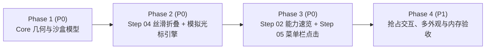

# Pharos 首次启动引导 V2 体验精修与交互动画技术规格书

> **前置基线**：本规格书建立在已合入主干的首次引导 V1（见 `docs/ONBOARDING_IMPLEMENTATION_SPEC.md`）之上。
> **核心目标**：解决真实体验中暴露的三大交互短板——重构第 2 步为高价值的「核心能力交互速览」、引入纯原生 SwiftUI「模拟鼠标点击编排动画」、彻底修复第 4 步切换「macOS 系统默认」时的折叠穿模与布局跳变。
> **硬性约束**：严格遵守仓库根目录 `AGENTS.md` 与 `DESIGN.md`（100% 纯 Apple 原生 Swift / SwiftUI、零第三方依赖、零视频/GIF 资源、最低兼容 **macOS 14 Sonoma**、严格 ARC 防泄漏、所有演示交互严禁未授权触碰真实硬件或系统进程）。

---

## 一、变更总览与设计取舍

| 维度 | V1 现状与痛点 | V2 目标方案 |
| :--- | :--- | :--- |
| **Step 02 页面定位** | 「读懂电源流向」仅展示抽象电路节点（适配器→主板→电芯），信息密度低，且让新用户误以为 Pharos 只是单一电池工具 | 替换为 **「核心能力交互速览（`OnboardingCapabilitiesStepView`）」**：通过微缩沙盒卡片 + **模拟鼠标点击**，一站式演示**内存膨胀治理、活跃端口管理、电池 80% 旁路直供（台式机自动切换温控风扇）、开发缓存清理**四大核心价值 |
| **交互引导动效** | 静态展示或单纯虚线流动，缺乏「怎么点、点了会发生什么」的直觉引导 | 新增通用纯矢量 **「模拟鼠标点击编排引擎（`SimulatedCursorOverlay`）」**，落地于 **Step 02** 与 **Step 05（常驻菜单栏）**：光标沿弹簧轨迹滑向真实控件锚点 → 按下微缩 + 同心圆波纹 → 控件凹陷并触发真实 UI 响应 |
| **Step 04 折叠过渡** | 点击「macOS 系统默认」收起限充面板时，滑块与圆环向上穿模遮挡分段选择器，且下方「通用设置」卡片脱节瞬移 | 引入基于 SwiftUI `Layout` + `Animatable` 的逐帧高度插值裁剪容器 **`OnboardingCollapsibleSection`**，配合外层容器统一事务动画与瞬态高斯柔化，实现无穿模、零文字重排、下方卡片丝滑跟进上移 |
| **资源与性能红线** | 引导关闭后 0 MB 常驻，静止后 0% GPU | **完全继承**：模拟光标与微缩工作台均为纯代码矢量绘制（增量 `< 30 KB`）；自动剧本仅单次播放并在结束后休眠；真人鼠标移入或点击即刻抢占并终止模拟光标 |

---

## 二、问题一修复规范：Step 04「定制基础偏好」无穿模弹簧折叠

### 2.1 现存 Bug 根因诊断（`OnboardingPreferencesStepView.swift`）
1. **向上穿模遮挡**：原实现使用 `if coordinator.draft.chargingChoice == .pharosLimit { limitPanel.transition(.opacity.combined(with: .move(edge: .top))) }`。收起时 `limitPanel` 向负 Y 轴位移，但父容器无裁剪边界，导致滑块、预设胶囊与进度环直接浮在顶部分段选择器（`Picker`）与标题文字表面。
2. **外层布局动画脱节**：`.animation(..., value: coordinator.draft.chargingChoice)` 仅挂载在 `chargingCard` 内部 `VStack`（原第 52 行），而承载 `[chargingCard, preferencesNotice, generalCard]` 的外层 `ScrollView` 内 `VStack`（原第 21 行）未纳入同一动画事务，导致上方卡片收缩时下方「通用设置」卡片生硬跳变。
3. **收起尾帧残留间距**：`chargingCard` 内部 `VStack` 固定 `spacing: PharosSpacing.m`，条件分支移除瞬间会产生一次额外的间距跳变。

### 2.2 精确重构方案

#### 1. 纯逻辑几何与瞬态模糊不变量（`PharosCore`）
在 `Sources/PharosCore/OnboardingPolicy.swift` 中新增 `OnboardingCollapseGeometry`（可单测）：
- 输入展开进度 `progress: Double`（裁剪至 `0.0 ... 1.0`）与 `level: OnboardingMotionLevel`：
  - `heightFraction = clamp(progress, 0, 1)`
  - `opacity = clamp((progress - 0.12) / 0.88, 0, 1)`（收起时内容略早于底边裁切淡出，视觉更通透）
  - `scaleY = level.allowsScale ? (0.96 + 0.04 * heightFraction) : 1.0`
  - **瞬态动态模糊**：`blur = level.allowsBlur ? sin(heightFraction * .pi) * 3.0 : 0.0`（当 `heightFraction == 0` 或 `heightFraction == 1` 时，`blur` 严格等于 **`0.0`**，确保两端静止态绝不触发离屏渲染缓冲）。

#### 2. 逐帧高度插值裁剪容器（`OnboardingCollapsibleSection.swift`）
新建 `Sources/Pharos/UI/Onboarding/Animations/OnboardingCollapsibleSection.swift`：
- 实现遵循 `Layout`（原生自带 `Animatable`）的内部布局器 `OnboardingRevealLayout(progress: Double)`：
  - `animatableData` 绑定 `progress`；
  - `sizeThatFits` 返回 `CGSize(width: full.width, height: full.height * progress)`，使 `PharosCard` 背景框与下方 `generalCard` 在 `60/120fps` 每一帧都按精确像素高度平滑跟进上移，彻底杜绝 `if/else` 条件移除带来的高度瞬移；
  - `placeSubviews` 始终向子视图提供完整的 `ProposedViewSize(width: bounds.width, height: full.height)` 并锚定于 `.topLeading`，保证收起全过程中多行安全提示文字不发生宽度挤压或折行抖动。
- 外层包裹修饰：
  - `limitPanel` 顶部自带 `.padding(.top, PharosSpacing.m)`（将 `chargingCard` 内 `Picker` 与折叠区的间距收进折叠容器内，`progress == 0` 时完全归零）；
  - 叠加 `OnboardingCollapseGeometry` 计算出的 `opacity`、`scaleEffect(x: 1, y: scaleY, anchor: .top)` 与 `blur(radius:)`；
  - 外层紧接 `.clipped()` 严格裁掉底边以下区域，彻底根除向顶部分段选择器穿模；
  - 当 `!isExpanded` 时附加 `.allowsHitTesting(false)` 与 `.accessibilityHidden(true)`。

#### 3. 统一动画事务（`OnboardingPreferencesStepView.swift`）
- 移除 `chargingCard` 局部孤立的 `.animation(...)`；
- 在承载 `[chargingCard, preferencesNotice, generalCard]` 的外层 `VStack` 上统一声明：
  `.animation(OnboardingMotion.collapseAnimation(level), value: coordinator.draft.chargingChoice)`
  其中 `collapseAnimation` 在非 `.minimal` 模式下使用高阻尼无回弹过冲弹簧 `.spring(response: 0.36, dampingFraction: 0.90)`（避免收起到底部时卡片反弹抖动）。

---

## 三、通用动效基建：纯 SwiftUI「模拟鼠标点击编排引擎」

为在 **Step 02** 与 **Step 05** 提供犹如 Apple 官方功能导览 / Screen Studio 级别的直观交互演示，构建零外部资源的模拟光标组件。

### 3.1 核心组件设计（`SimulatedCursorOverlay.swift`）

1. **锚点自动定位（禁止硬编码像素坐标）**
   - 定义 `OnboardingCursorTargetKey: PreferenceKey`，值类型为 `[String: Anchor<CGRect>]`。
   - 提供视图扩展 `.onboardingCursorTarget(_ id: String)`：挂在需要被模拟点击的真实按钮、分段项或状态栏图标上。
   - 顶层 `OnboardingCursorStage` 通过 `.overlayPreferenceValue(OnboardingCursorTargetKey.self)` 结合 `GeometryReader` 实时解算任意 `targetID` 的中心坐标 `CGPoint`（并可加 `(x: +2, y: +3)` 视觉微偏，使箭头尖端自然落在按钮中偏左位置，不遮挡核心文字）。无论中英文切换或字体缩放，落点永远精准。

2. **纯矢量 macOS 指针造型（`SimulatedMacCursorView`）**
   - 使用 SwiftUI `Path` / `Canvas` 绘制标准 macOS 左上倾角箭头指针（画布约 `20×24 pt`，尖端严格位于局部 `(0, 0)`）：
     - 内部填充近黑（`Color(white: 0.08)`），外圈描边纯白（`Color.white`，线宽 `1.4pt`，`lineJoin: .round`），附带柔和投影 `.shadow(color: .black.opacity(0.28), radius: 3.5, x: 0, y: 1.5)`——在浅色与深色卡片表面均具备极高辨识度。
   - **点击水波纹（Click Ripple）**：在箭头尖端 `(0, 0)` 叠放一枚单次触发的圆环 `Circle().stroke(PharosColor.accentFill.opacity(rippleOpacity), lineWidth: 1.5)`，点击瞬间直径由 `6pt` 扩至 `34pt` 同时透明度归零（纯属性驱动动画，无需常驻 `TimelineView`）。

3. **单步点击微编排节奏（`OnboardingCursorStep` in `PharosCore`）**
   在 `PharosCore/OnboardingPolicy.swift` 定义剧本帧值类型：
   ```swift
   public struct OnboardingCursorStep: Equatable, Sendable {
       public let targetID: String
       public let moveDuration: Double    // 默认 0.50s，弹簧滑行至目标
       public let aimPause: Double        // 默认 0.14s，到达后短暂停顿（模拟人眼瞄准）
       public let pressDuration: Double   // 默认 0.10s，光标缩至 0.86x + 目标控件呈现按下态
       public let dwellAfterClick: Double // 默认 1.05s，释放触发回调 + 水波纹扩散 + 留出时间观察界面响应
   }
   ```
   - **运动动态模糊**：当 `level == .rich` 且光标处于滑行阶段（`isMoving == true`）时，仅对 `SimulatedMacCursorView` 自身施加轻量 `.blur(radius: 1.2)`，落定瞄准时即刻归 `0`。
   - **控件同步凹陷反馈**：编排器暴露 `@Binding var activePressedTargetID: String?`，目标按钮读取 `activePressedTargetID == myID` 时同步应用 `scaleEffect(0.95)` 与按压底色，做到「光标按下 = 按钮真被按下」的物理耦合感。

4. **真人优先抢占（Human-First Preemption）与休眠铁律**
   - 舞台容器监听 `.onContinuousHover { phase in if case .active = phase { controller.cancelByUser() } }` 及任意手动点击事件：
     - **一旦用户的真实鼠标移入演示卡片或发生点击**，模拟光标在 `0.16s` 内淡出隐藏，剧本 `Task` 立即 `cancel()`，控制权 100% 交还用户，绝不出现双鼠标冲突。
   - 自动剧本在每次进入页面时最多播放 **1 轮**，最后一帧结束后光标自动淡出（`opacity → 0`），页面进入零动画静止态（CPU `< 1%`、GPU `0%`）。
   - 若 `level == .minimal`（系统开启「减弱动态效果」），完全不渲染模拟光标，所有控件直接处于可手动点击稳态。

---

## 四、问题二重构规范：Step 02「核心能力交互速览」

### 4.1 页面架构与路由替换
- **移除文件**：
  - 删除 `Sources/Pharos/UI/Onboarding/Steps/OnboardingPowerIntroStepView.swift`
  - 删除 `Sources/Pharos/UI/Onboarding/Animations/PowerFlowDiagramView.swift`
- **新增文件**：
  - `Sources/Pharos/UI/Onboarding/Steps/OnboardingCapabilitiesStepView.swift`
- **枚举更新**：
  - `OnboardingStep`（`PharosCore/OnboardingPolicy.swift`）将 `case powerIntro` 改为 `case capabilities`（`rawValue == 1` 保持不变，`stepCount == 6` 保持不变，不影响断点恢复索引）。

### 4.2 视觉布局与四大核心能力沙盒（适配 `720×520` 窗口）

遵循 `OnboardingStepScaffold` 统一顶栏节奏，主体由 **「顶部 4 枚能力胶囊切换栏」+「中央微缩沙盒工作台卡片（`maxWidth: 580`）」+「顶部沙盒免责徽章」** 构成：

- **沙盒安全徽章**：右上角固定展示 `PharosTag`（`交互演示 · 不修改本机进程与文件` / `Interactive preview · Leaves your Mac untouched`），明确告知演示操作为沙盒模拟。
- **4 大能力模块定义（`OnboardingCapabilityKind` in `PharosCore`）**：

| 模块枚举 | 标签名称（中 / 英） | 初始沙盒界面（点击前） | 模拟鼠标（或用户手动）点击目标后的动态响应 |
| :--- | :--- | :--- | :--- |
| `.memory` | 内存治理 / Memory | 展示内存压力条（`78% · 偏高`）与典型膨胀后台项示例行：`mediaanalysisd · 2.4 GB` + 右侧按钮 **「一键释放」**（锚点 `"cap.act.memory"`） | 按钮凹陷并绽放波纹 → 膨胀项标记「已安全回收」，顶部占用率通过 `.numericText` 丝滑滚落至 **`61%`**，压力指示转为绿色「健康」 |
| `.ports` | 活跃端口 / Ports | 展示两条本地开发服务行：`next-server (:3000 · 412 MB)` 与 `vite (:5173 · 186 MB)`，`:3000` 右侧带 **「结束服务」** 按钮（锚点 `"cap.act.ports"`） | 点击 `:3000` 结束按钮 → 该行带弹簧裁剪折叠收起，监听端口计数由 `2` 滚落为 **`1`**，直观传达「告别命令行查杀残留端口」 |
| `.power`（有电池）<br>`.thermals`（无电池 Mac） | 电池护航 / Battery<br>*(台式机：散热风扇 / Thermals)* | **笔记本**：展示电池卡片（`80% · 电源已连接 · 电芯电流 +1,480 mA`）与 **「开启 80% 限充直通」** 切换按钮（锚点 `"cap.act.power"`）<br>**台式机**：展示芯片峰值温度与风扇转速卡片 + **「切换散热视图」** 按钮 | **笔记本**：点击后电芯电流滚落至 **`0 mA`**，图标由 `bolt.fill` 替换为小插头 `powerplug.fill`，浮现精炼说明「适配器直通主板供电，零循环损耗」（用 3 秒真实卡片交互替代原抽象电路图）<br>**台式机**：切换显示多传感器温度排行与转速状态 |
| `.cleanup` | 缓存清理 / Cleanup | 展示开发缓存列表（`Xcode DerivedData · 4.6 GB`、`Homebrew / npm · 2.2 GB`）与底部标签「仅清理超期文件 · 保留目录」，右侧带 **「清理超期缓存」** 按钮（锚点 `"cap.act.cleanup"`） | 点击后进度条轻扫完成，可释放空间由 `6.8 GB` 滚落归零，切换为绿色「已安全释放 6.8 GB」完成态徽章 |

- **面板内切换过渡**：切换顶部 4 枚能力胶囊时，中央微缩卡片内部采用轻量交叉淡入 + 微缩放模糊（`blur 3pt → 0pt`，`0.24s`），卡片外框稳固不跳动；每个模块底部还带有 1 行小字按需展示本机当前真实只读快照（例如当前本机真实活跃端口数 / 真实内存百分比 / 真实电池百分比），兼顾演示趣味性与真实感。

### 4.3 Step 02 模拟鼠标自动巡演剧本（约 6.2 秒后静默退场）
进入 Step 02 且 `level != .minimal` 时：
1. **初始停留**（`0.45s`）：默认展示第 1 项 `.memory`；
2. **动作 1**：模拟光标滑向 `"cap.act.memory"`（「一键释放」按钮）并点击 → 演示内存 `78% → 61%` 回落；
3. **动作 2**：观察 `1.0s` 后，光标上移滑向顶部第 2 枚胶囊 `"cap.tab.ports"` 点击切换到「活跃端口」→ 随后滑向 `"cap.act.ports"` 点击结束 `:3000` 端口；
4. **动作 3**：观察 `0.9s` 后，光标滑向第 3 枚胶囊 `"cap.tab.power"`（台式机为 `"cap.tab.thermals"`）点击切换 → 再滑向 `"cap.act.power"` 点击开启「80% 限充直通」（展示 `0 mA` 直通小插头状态）；
5. **退场**：观察 `0.9s` 后模拟光标平滑淡出（`opacity → 0`），全程结束，GPU 归零；用户可随时点击第 4 项「缓存清理」或点击「重置演示」自由体验。

---

## 五、问题三落地规范：Step 05「常驻菜单栏」模拟鼠标点击编排

### 5.1 交互剧本升级（`OnboardingMenuBarStepView.swift`）
原实现进入 Step 05 时下拉框已处于静态展开态（`expanded = true`），缺乏「从菜单栏点开」的直觉建立。V2 升级如下：

1. **初始状态区分**：
   - 当 `level == .minimal`（减弱动态效果）：保持 `expanded = true` 直接静态展示；
   - 当 `level >= .reduced`：初始 `expanded = false`（仅展示顶部模拟 macOS 菜单栏条，其中包含真实的 `MenuBarLabel(store: store)`，实时反映用户在 Step 04 刚选好的图标旁电量%/内存配置）。
2. **两步模拟点击剧本（总长约 3.6 秒）**：
   - **第 1 击（点开菜单栏图标）**：进入页面 `0.45s` 后，模拟光标从右下方滑向模拟菜单栏中的 Pharos 图标（挂载 `.onboardingCursorTarget("menubar.icon")`）→ 按下微缩并绽放点击波纹 → 触发 `expanded = true`，下方真实 `PopoverTabsContent` 以 `.topTrailing` 为锚点带弹簧缩放（`0.94 → 1.0`）+ 瞬态高斯模糊（`4.5pt → 0pt`）清脆弹出！
   - **第 2 击（切换下拉面板标签）**：若 `layoutStore.layout.visibleTabs.count > 1`（存在「概览」与「项目」两个标签），停顿 `1.1s` 让用户看清概览卡片（含 Step 04 勾选置顶的电池卡片），随后模拟光标滑向 `PopoverTabsContent` 顶部分段选择器的第 2 个标签位置（挂载 `.onboardingCursorTarget("menubar.secondTab")`）→ 点击波纹 → 触发 `previewTab = visibleTabs[1]`，展示下拉面板平滑弹性伸缩高度并切换至「项目」页。
   - **退场**：停顿 `0.85s` 后模拟光标淡出隐藏。此后用户若用真实鼠标点击模拟菜单栏图标或分段选择器，同样可自由收起/展开或切换标签。

### 5.2 `PopoverTabsContent` 预览动效小幅增强（`PopoverView.swift`）
- 当前 `PopoverTabsContent`（`Sources/Pharos/UI/PopoverView.swift` 第 168 行）中 `isBlurActive` 判定为 `interactive && popoverGaussianBlur && !systemReduceMotion`，导致 Step 05 传入 `interactive: false` 时连带关闭了标签切换与高度自适应动画。
- **安全解耦修改**：
  - 为 `PopoverTabsContent` 新增默认参数 `var previewAnimations: Bool = false`（不影响「自定义下拉框」页）；
  - 将 `isBlurActive` 改为 `(interactive || previewAnimations) && popoverGaussianBlur && !systemReduceMotion`；
  - 内部 `PopoverBlockStack` 继续严格保持 `.allowsHitTesting(interactive)`（即 Step 05 中仍为 `false`，确保演示绝不误点真实进程的「停止」按钮）。
  - 在 `PopoverTabsContent` 顶部分段选择器（`tabs.count > 1` 时）的第二个标签区域叠加透明几何探测背景上报 `.onboardingCursorTarget("menubar.secondTab")`，使模拟光标精准落在该分段按钮中心。

---

## 六、涉及文件变更全景

```text
Sources/PharosCore/
└── OnboardingPolicy.swift                        # [修改] OnboardingStep.powerIntro -> .capabilities；
                                                  #        移除 PowerDemoFlow；新增 OnboardingCollapseGeometry、
                                                  #        OnboardingCursorStep、OnboardingCapabilityDemo

Sources/Pharos/UI/
├── L10n.swift                                    # [修改] 替换 Step 02 双语文案为四大核心能力沙盒词条
├── PopoverView.swift                             # [修改] PopoverTabsContent 支持 previewAnimations 与第二标签光标锚点
└── Onboarding/
    ├── OnboardingMotion.swift                    # [修改] 补充 collapseAnimation(_:) 无过冲弹簧曲线
    ├── OnboardingView.swift                      # [修改] case .capabilities 路由至 OnboardingCapabilitiesStepView
    ├── Animations/
    │   ├── OnboardingCollapsibleSection.swift    # [新增] Layout + Animatable 逐帧高度裁剪无穿模折叠容器
    │   ├── SimulatedCursorOverlay.swift          # [新增] 锚点收集器、纯矢量 macOS 光标、水波纹与抢占式剧本编排器
    │   └── PowerFlowDiagramView.swift            # [删除] 退役旧抽象电路导管视图
    └── Steps/
        ├── OnboardingCapabilitiesStepView.swift  # [新增] Step 02 四大核心能力微缩交互工作台 + 模拟鼠标巡演
        ├── OnboardingPowerIntroStepView.swift    # [删除] 退役旧电源流向单页
        ├── OnboardingPreferencesStepView.swift   # [修改] Step 04 接入 OnboardingCollapsibleSection 与外层统一动画
        └── OnboardingMenuBarStepView.swift       # [修改] Step 05 接入模拟鼠标点击图标展开 Popover + 切换标签

Sources/pharos-tests/
└── OnboardingTests.swift                         # [修改] 覆盖折叠几何静止态 0 模糊、能力沙盒状态转换与光标剧本校验
```

---

## 七、分阶段实施计划（Phased Rollout Plan）

> **硬性工程纪律**：共拆分为 **4 个独立可编译、可单测的 Phase**。每个 Phase 结束时必须执行 `swift build` 与 `make test` 全绿通过后方可进入下一阶段；异步 `Task` 与闭包严格遵守 `AGENTS.md` 第 2 节内存管理守则。



---

### Phase 1：Core 纯逻辑模型与单测先行（优先级：P0）
- **阶段目标**：在 `PharosCore` 中完成折叠几何纯函数、模拟光标剧本数据结构、四大核心能力沙盒状态机与单元测试更新，确保数学不变量（如静止态 `blur == 0`）先行锁定。
- **涉及文件**：
  - `[修改]` `Sources/PharosCore/OnboardingPolicy.swift`
  - `[修改]` `Sources/Pharos/UI/Onboarding/OnboardingView.swift`（临时将 `.capabilities` 指向现有视图以保持编译通过）
  - `[修改]` `Sources/pharos-tests/OnboardingTests.swift`
- **准出验收（Exit Gate）**：
  - `swift build` 零错误；
  - `make test` 全绿，`OnboardingTests` 新增断言覆盖：
    1. `OnboardingCollapseGeometry` 在 `progress == 0` 与 `progress == 1` 时 `blur == 0`，在 `progress == 0.5` 且 `level == .rich` 时 `blur > 0`，在 `.minimal` / `.reduced` 时 `blur == 0`；
    2. `OnboardingCapabilityDemo` 在有电池/无电池 Mac 下返回正确的 4 项能力序列，且点击动作前后数值（如内存 `78 -> 61`、端口 `2 -> 1`、电芯电流 `1480 -> 0`、缓存 `6.8 -> 0`）转换确定无误；
    3. `OnboardingCursorStep` 时间参数非负且总时长在合理上限（`< 8s`）内。

---

### Phase 2：Step 04 无穿模弹簧折叠修复与通用模拟鼠标引擎（优先级：P0）
- **阶段目标**：彻底修好 Step 04 点击「macOS 系统默认」时的收起动画，并完成可复用的 `SimulatedCursorOverlay` 锚点光标引擎。
- **涉及文件**：
  - `[新增]` `Sources/Pharos/UI/Onboarding/Animations/OnboardingCollapsibleSection.swift`
  - `[修改]` `Sources/Pharos/UI/Onboarding/OnboardingMotion.swift`
  - `[修改]` `Sources/Pharos/UI/Onboarding/Steps/OnboardingPreferencesStepView.swift`
  - `[新增]` `Sources/Pharos/UI/Onboarding/Animations/SimulatedCursorOverlay.swift`
- **关键实现检查**：
  - Step 04 来回快速切换「macOS 系统默认」↔「Pharos 充电上限保护」10 次以上：滑块与圆环**绝不向上越过分段选择器下沿**，文字不挤压折行，下方「通用设置」卡片像素级平滑上移与下推，收起完成后无多余空白缝隙；
  - `SimulatedCursorOverlay` 的剧本 `Task` 绑定在 SwiftUI `.task(id:)` 生命周期上，页面切走（`onDisappear`）自动取消，无强引用环。
- **准出验收（Exit Gate）**：`swift build` 与 `make test` 全绿，零编译警告。

---

### Phase 3：Step 02「核心能力交互速览」重构与 Step 05 菜单栏点击联调（优先级：P0）
- **阶段目标**：上线全新的 Step 02 微缩交互工作台（含模拟光标巡演），清理旧电路图文件，并为 Step 05 菜单栏接入模拟光标「点图标展开 + 点标签切换」完整闭环。
- **涉及文件**：
  - `[新增]` `Sources/Pharos/UI/Onboarding/Steps/OnboardingCapabilitiesStepView.swift`
  - `[删除]` `Sources/Pharos/UI/Onboarding/Steps/OnboardingPowerIntroStepView.swift`
  - `[删除]` `Sources/Pharos/UI/Onboarding/Animations/PowerFlowDiagramView.swift`
  - `[修改]` `Sources/Pharos/UI/Onboarding/OnboardingView.swift`
  - `[修改]` `Sources/Pharos/UI/PopoverView.swift`
  - `[修改]` `Sources/Pharos/UI/Onboarding/Steps/OnboardingMenuBarStepView.swift`
  - `[修改]` `Sources/Pharos/UI/L10n.swift`
- **关键实现检查**：
  - Step 02 所有按钮点击仅修改局部 `@State` 沙盒模型，**绝不调用** `ProjectStore.terminate`、`DiskCleaner` 或 `BatteryStore` 写接口；
  - Step 05 模拟光标先点击菜单栏 Pharos 图标弹出面板，再点击切换到第二个标签页（当可见标签数 `> 1` 时），面板内部块保持不可误触；
  - 所有新增界面文案 100% 走 `L10n.swift`，同时提供地道中文与英文。
- **准出验收（Exit Gate）**：`swift build` 与 `make test` 全绿；旧 `PowerFlowDiagramView` 相关未用符号清理干净。

---

### Phase 4：真人鼠标抢占、多外观走查与零内存残留验收（优先级：P1）
- **阶段目标**：打磨真实交互边界手感，验证性能与内存红线。
- **执行清单**：
  1. **真人鼠标抢占测试**：在 Step 02 或 Step 05 模拟光标正在移动途中，将真实鼠标移入卡片或手动点击任意标签——模拟光标必须在 `0.2s` 内干净消失，不与真实鼠标抢焦点、不把用户刚点的标签又强行切走。
  2. **连点翻页中断测试**：在模拟光标动画播放中途快速点击底部「继续 / 返回」，Zoom-Blur 页面转场依然丝滑，无异步回调报错或残留任务。
  3. **多外观与无障碍走查**：浅色 / 深色模式下矢量黑白描边光标均清晰锐利；中英文双语切换时模拟光标依然准确命中按钮中心；开启系统「减弱动态效果」时隐藏模拟光标且 Step 04 折叠降级为柔和淡入淡出。
  4. **性能与内存终验**：执行 `make app` / `make install` 体验完整 6 步，在任一页面静置 8 秒后确认 CPU `< 1%`、GPU `0%`；完成引导并关闭主窗口后运行 `vmmap --summary $(pgrep -x Pharos)` 确认 `IOSurface` 脏内存归零。

---

## 八、最终总体验收清单（Definition of Done）

- [ ] `swift build` 零错误零新增警告，`make test` 全部断言通过。
- [ ] `Package.swift` 无任何第三方依赖，最低部署目标保持 `.macOS(.v14)`，无外部视频/GIF/Lottie 资源。
- [ ] **Step 04 修复确认**：点击「macOS 系统默认」时，限充面板平滑裁剪收起，无任何文字或滑块穿过顶部分段选择器，下方「通用设置」卡片丝滑同步上移。
- [ ] **Step 02 体验确认**：原抽象电源流向图已替换为「核心能力交互速览」（内存、端口、电池/温控、清理），模拟鼠标自动演示点击并触发数值滚动与状态反馈，且真实系统进程/文件/电源零改动。
- [ ] **Step 05 体验确认**：进入页面时模拟光标滑向菜单栏点击 Pharos 图标弹出真实 Popover 预览，并演示标签切换；Step 04 勾选的电池卡片与状态栏文字在 Step 05 中实时可见。
- [ ] **抢占与静默确认**：真实鼠标移入演示区域即刻接管控制权；剧本播放完毕后光标自动淡出，静止态 0% GPU 占用，关闭引导窗口后 0 MB 图形内存残留。

---

## 九、实施记录（与上文的差异，以本节为准）

| 项 | 规格原文 | 实际落地 | 原因 |
| :--- | :--- | :--- | :--- |
| Step 02 巡演 | 演示内存、端口、电池三项，缓存清理留给用户 | 四项全部演示，以缓存清理收尾（进度条扫过 + GB 滚落 + 完成徽章，停留 1.2s） | 审计反馈：巡演结束时缓存清理没有动画 |
| 剧本总时长上限 | `< 8s` | `< 10s`（Step 02 实际约 7.9s） | 多了缓存清理一段 |
| 真人抢占 | 鼠标一移入即接管 | 移动超过 3 pt 或点击才接管 | 页面出现时指针恰好停在卡片上会触发 hover，导致剧本未播即取消 |
| Step 05 | 复用真实 `MenuBarLabel` + `PopoverTabsContent`，并给后者加 `previewAnimations` | 独立 Demo，`PopoverView.swift` 未改动。示例数据用真实模型类型（`SystemMemoryStats` / `Project` / `ListeningPort`），交给真实组件绘制（`DynamicMenuBarIcon`、`MemoryCompositionBar`、`PressureBadge`、`ProjectMemoryBars`、`PortChips`、`MemoryBar`），文案复用真实 `L10n` 键（总览 / 项目、开发端口、本机内存…） | 审计反馈：页面不应随用户自己的菜单栏/布局变化，但样式必须与真实 App 一致 |
| Step 05 内容区 | — | 整体 `allowsHitTesting(false)`；示例项目 `directory == nil`，不读磁盘 | 演示不得触碰真实进程、收藏或文件 |
| Step 04 圆环 | — | 描边 `inset(by: 3)` 收入框内，左右各留 8 pt | 折叠容器 `.clipped()` 裁掉了外溢描边，看起来贴住窗口边 |
| 折叠容器动画 | 直接叠加 opacity / scale / blur 修饰 | 包进 `Animatable` 修饰器，每帧按插值后的 progress 重新计算 | 普通修饰器只在两端值之间插值，两端 blur 均为 0，sin(π·p) 模糊不会出现 |

**待人工验收**：真人抢占手感、翻页中断、浅/深色 × 中英文、关闭引导后 `vmmap --summary` 的 IOSurface 归零。
