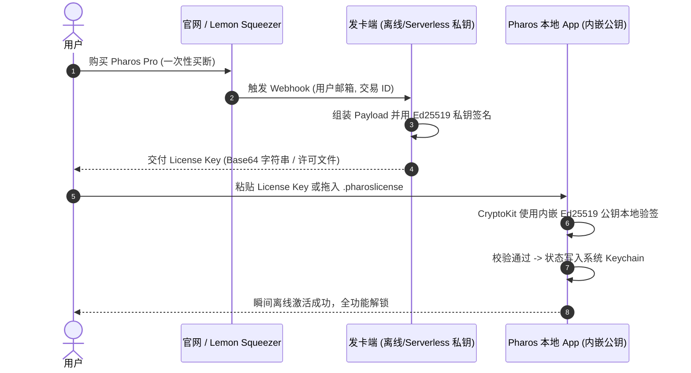

# Pharos 收费边界与商业化方案 (Pricing & Capability Boundary)

> **版本**：v1.0 (针对 Pharos v3.0+)  
> **文档定位**：内部商业化设计与产品边界规范  
> **生效原则**：本轮仅产出决策规范文档，不改动任何业务源码，不引入第三方依赖，不修改 entitlements 与签名配置。

---

## 一、核心原则与商业定位

### 1.1 产品定位与一句话边界
Pharos 定位为**“本地开发环境的灯塔”**（Mac 本地端口、内存与运行环境守望者）。
- **一句话收费边界**：
  > **“核心监控、资源排查与失控进程终止永久免费；系统级硬件接管、特权守护与进阶开发环境治理一次性买断。”**

### 1.2 为什么坚持免费版“真正好用，绝不残废”
作为面向工程师和高级开发者的本地效率工具，**工具的信任资产高于前期的收费漏斗**。
- **好用的免费版是最好的分发渠道**：监听端口按工作区归组、子进程内存精确合并、系统内存压力走势、以及先 `SIGTERM` 后 `SIGKILL` 终止占用端口的失控进程，是开发者日常最痛的高频刚需。这一核心闭环必须完全免费，且没有任何弹窗骚扰。
- **残废版只会招致卸载与反感**：如果用户能看到某个端口被占用，却被弹窗阻拦“升级 Pro 才能结束进程”或“升级 Pro 才能看端口是谁占的”，会导致口碑崩塌。
- **免费版提供最强的转化锚点**：免费版提供高精度的硬件与环境只读遥测（例如“电池电量已充至 100%”、“有 4.2 GB 孤立 AI 对话数据库未清理”），用户在获得确切信息后，会自然而然地产生“一键接管/清理”的高意愿付费转化。

### 1.3 为什么坚持“一次性买断，绝不做订阅制”
1. **零服务器运行时成本**：Pharos 纯 Swift 编写，不发起任何网络请求，零云端 API 依赖，零后端数据库开销。向用户收取持续订阅费缺乏客观成本依据。
2. **开发者群体的反订阅心理**：当今开发者工具充斥着各色 SaaS 订阅，纯本地离线单机工具采用订阅制极易引发社区抵触；一次性买断（Lifetime License）是 Mac 独立开发工具领域（如 Alfred、Tower、TablePlus、Paw/RapidAPI、AlDente 等）最受推崇的商业模式。
3. **持续收入的解决路径**：通过**大版本付费升级**（Major Version Paid Upgrades，如 v3.x 终身维护，v4.x 推出突破性重磅功能时提供半价升级折扣）以及早期锁定、后期阶梯提价来保障独立开发者的长期健康现金流。

---

## 二、功能全景与商业对照表

经过对 Pharos v3.0 全量代码库（`PharosCore`、`Pharos` App、`pharos-fand`、`pharos-battd`）的深度审计，各功能模块的归属与 Gating（功能开关）难度对照如下：

| 功能模块 | 对应源码位置 | 归属建议 | Gating 难度 | 核心设计理由与技术切入点 |
| :--- | :--- | :---: | :---: | :--- |
| **端口与项目归组监控** | `PharosCore/ProcessScanner.swift`<br>`PharosCore/ProjectGrouper.swift`<br>`Pharos/UI/OverviewPages.swift` | **免费** | 无 | 核心立足之本。列出监听 TCP 端口、按工作目录归组、合并子进程内存、显示外部暴露标识（🌐）。 |
| **整机内存压力与 1 小时趋势** | `PharosCore/SystemMemory.swift`<br>`PharosCore/MemoryHistory.swift`<br>`Pharos/UI/OverviewPages.swift` | **免费** | 无 | 核心基础遥测。与系统活动监视器口径一致的物理内存占用、联动/压缩/缓存拆解、1 小时趋势图。 |
| **应用内存消耗排行** | `PharosCore/AppGrouper.swift`<br>`Pharos/UI/PopoverBlocks.swift` | **免费** | 无 | 合并 Helper 进程（如 Chrome/Electron）的顶级应用内存排行，快速定位内存大户。 |
| **终止失控进程 / 项目** | `PharosCore/ProcessScanner.swift`<br>`Pharos/ProjectStore.swift` | **免费** | 无 | 核心治理闭环。提供先 `SIGTERM`、存活 1.5s 后升格 `SIGKILL` 的安全终止逻辑，不碰 PID≤1、系统进程与自身。 |
| **磁盘卷用量概览与详情** | `PharosCore/DiskVolumes.swift`<br>`Pharos/UI/DiskUsageView.swift` | **免费** | 无 | 纯只读监控。通过 `mountedVolumeURLs` 与 DiskArbitration 识别启动盘、外接盘、网络共享与镜像卷。代码仅 110 行且纯只读，强行拆分缺乏用户心智价值。 |
| **动态菜单栏环形图标与快捷键** | `Pharos/MenuBarSettings.swift`<br>`Pharos/Notifier.swift` | **免费** | 无 | 品牌认知与常驻体验。CoreGraphics 原生渲染的动态用量圆环、状态指示点、快捷键呼出与本地严重告警。 |
| **电池硬件与供电回路监控（只读）** | `PharosCore/BatteryScanner.swift`<br>`PharosCore/BatteryModels.swift`<br>`Pharos/UI/BatteryControlView.swift` | **免费** | 无 | 纯只读数据。电量、循环次数、健康度 %、电压、当前电芯电流（mA）与电源流向判断（直通/充电/补电）。作为限充的转化入口。 |
| **电池充电上限与合盖保活** | `pharos-battd/main.swift`<br>`PharosCore/BatteryPolicy.swift`<br>`Pharos/BatteryStore.swift` | **Pro** | **Level 1 (极低)** | **系统级硬件接管**。通过特权 daemon 写入 SMC 维持 80%~95% 充电上限、模拟原生未充电小插头、合盖休眠与重启保活、MagSafe 颜色同步。在 `BatteryStore.apply` 与 UI 控制器处拦截。 |
| **风扇转速与传感器温度监控（只读）** | `PharosCore/SMC.swift`<br>`PharosCore/Thermals.swift`<br>`Pharos/UI/ThermalView.swift` | **免费** | 无 | 纯只读数据。通过 AppleSMC 读取 CPU/GPU/SSD/RAM 温度与风扇转速，配合经典条状卡片展示。 |
| **风扇转速手动控制** | `pharos-fand/main.swift`<br>`PharosCore/FanPolicy.swift`<br>`Pharos/FanStore.swift` | **Pro** | **Level 1 (极低)** | **系统级硬件干预**。通过特权 helper 向 SMC 写入 `Ftst`/`F%dMd`，支持固定转速与强制满速，内置 ≥95°C 强制满速安全规则。在 `FanStore.apply` 与安装按钮处拦截。 |
| **磁盘清理：扫描与分析** | `PharosCore/DiskCleaner.swift`<br>`Pharos/CleanupStore.swift` | **免费** | 无 | 完整扫描临时文件、应用缓存、Xcode 工具链与包管理器缓存，透明展示实际可释放空间，打消用户疑虑。 |
| **磁盘清理：一键执行与深度清理** | `PharosCore/DiskCleaner.swift`<br>`Pharos/CleanupStore.swift`<br>`Pharos/UI/CleanupView.swift` | **Pro** | **Level 1 (极低)** | **实际磁盘写操作**。按文件安全删除、回收空目录、自定义保留期（1h/6h/1d/3d）。在 `cleanAll()`、`clean(group:)` 与 `cleanOne(id:)` 处弹窗拦截。 |
| **常用项目：基础收藏与状态监测** | `PharosCore/Workspaces.swift`<br>`Pharos/WorkspaceStore.swift` | **免费** | **Level 1 (极低)** | 允许免费用户收藏 **最多 3 个** 核心项目，体验命令自动探测与端口运行状态联动。 |
| **常用项目：无限收藏与进阶管理** | `Pharos/WorkspaceStore.swift`<br>`Pharos/UI/FavoritesViews.swift` | **Pro** | **Level 1 (极低)** | 解锁无上限项目收藏、自定义终端切换（iTerm2、Ghostty、Warp）、历史端口记录。在 `addFolder()` 与 `pin()` 处判断上限。 |
| **浏览器实例：运行态监控与查看** | `PharosCore/ChromeInstances.swift`<br>`Pharos/ChromeStore.swift` | **免费** | 无 | 自动识别运行中的 Chrome/Edge/Brave 调试实例、端口、代理与内存，避免调试浏览器混入普通进程。 |
| **浏览器实例：预设收藏、新建与一键启动** | `Pharos/ChromeStore.swift`<br>`Pharos/UI/ChromeView.swift` | **Pro** | **Level 1 (极低)** | 独立 Profile 环境编排。自动分配隔离端口与 `--user-data-dir`、预设保存、退出后常驻、一键多开调试实例。在 `addPreset()`、`save()` 与 `start()` 拦截。 |
| **AI 对话库：全局扫描与孤立工作区预警** | `PharosCore/AgentChats.swift`<br>`PharosCore/AgentChatCatalog.swift`<br>`Pharos/AgentChatStore.swift` | **免费** | 无 | 自动发现 23+ 种 AI 编辑器 SQLite 库、增量指纹秒开、占用图表、会话元数据预览、标红识别孤立残留数据库。 |
| **AI 对话库：孤立库安全清理与数据库备份** | `Pharos/AgentChatStore.swift`<br>`PharosCore/AgentScanner+CustomApp.swift` | **Pro** | **Level 1 (极低)** | 释放 GB 级残留空间、双重红色确认安全删除、完整数据库备份导出、手动添加 `/Applications` 任意 App 定向探测。在 `deleteEntry`、`backupEntry` 与 `addCustomApplication` 拦截。 |
| **Packages：全局 CLI 与依赖管理大盘** | `PharosCore/PackageScanner.swift`<br>`Pharos/PackageStore.swift`<br>`Pharos/UI/PackageView.swift` | **Pro** | **Level 1 (极低)** | 开发者进阶环境套件。Homebrew 深度管理与一键终端诊断、全局 CLI 工具展架与一键安全卸载、全技术栈依赖（`node_modules`、`.venv` 等）洞察与语言缓存清理。整页作为 Pro 专属能力。 |
| **Popover 菜单栏组件拖拽自定义** | `PharosCore/PopoverLayout.swift`<br>`Pharos/PopoverLayoutStore.swift`<br>`Pharos/UI/CustomizePopoverView.swift` | **待决策** *(建议 Pro)* | **Level 1 (极低)** | 默认提供官方精选的 Standard 紧凑双 Tab 布局；自由拖拽排序、增删模块、跨 Tab 移动与自定义展示行数列为 Pro 特权。 |
| **风扇拟真机车仪表盘座舱 (Speedometer)** | `Pharos/UI/FanSpeedometerView.swift`<br>`PharosCore/FanGaugeMath.swift` | **待决策** *(建议免费)* | **Level 1 (极低)** | 60FPS 物理惯性阻尼与动态高斯运动模糊表盘。虽属高质感特色，但作为视觉招牌能大幅提升社交传播与口碑转化，建议全员免费。 |

---

## 三、拟收费功能的 Gating 技术可行性评估

在现有纯 Swift 架构下，拟收费功能的 Gating 实现极其轻量且架构解耦，没有任何难以拆分的“意大利面”耦合代码：

### 3.1 Gating 难度等级定义
- **Level 1 (极低)**：业务逻辑已天然封装在独立方法或独立 Store 中，仅需在执行动作前加入 `guard LicenseManager.shared.isPro else { showPaywall(); return }`，或在 SwiftUI 视图顶层覆上 `ProUnlockOverlay`。
- **Level 2 (低)**：涉及少量数据条数判断（如数组长度阈值限制）或简单的 UI 状态分支。
- **Level 3 (中)**：涉及跨进程通信协议修改或核心扫描管线深层剪裁（Pharos **不存在**此级别问题）。

### 3.2 重点模块 Gating 实施细节

#### ① 电池硬件充电限制 (`BatteryStore.swift`)
- **解耦现状**：`BatteryScanner` 负责采集遥测（免费），`BatteryStore` 通过 Unix socket 向 `pharos-battd` 发送控制指令。
- **Gating 切入点**：
  - 核心入口：`BatteryStore.selectLimit(_:)`、`apply(_:)`、`chargeToFullNow()`、`resumeLimit()`。
  - UI 表现：免费用户在 `BatteryControlView` 中，限充滑块、预设药丸按钮、合盖保活 Toggle 置灰禁用，卡片右上方显示优雅的琥珀色 `PRO` 徽标；点击时弹出轻量购买/激活 Sheet。
  - 降级兜底：未激活状态下，`pharos-battd` 守护进程默认不安装；已安装者在 License 失效时退回系统默认（`.system`）。

#### ② 磁盘清理执行 (`CleanupStore.swift` & `DiskCleaner.swift`)
- **解耦现状**：扫描方法 `rescan()` 计算出各 Target 的字节数与文件列表，清理方法 `DiskCleaner.clean()` 独立执行 unlink。
- **Gating 切入点**：
  - 扫描完全开放，用户可见所有详细明细。
  - 在 `CleanupStore.cleanAll()`、`clean(group:)`、`cleanOne(id:)` 中执行拦截。
  - UI 表现：各个清理操作按钮（“一键清理”、“清理本组”）带有微型锁标或 PRO 标签，点击时唤起付费引导。

#### ③ 常用项目数量限制 (`WorkspaceStore.swift`)
- **解耦现状**：`favorites` 数组统一由 `UserDefaults` 持久化，由 `WorkspaceStore` 集中管理。
- **Gating 切入点**：
  - 在 `addFolder()` 与 `pin(_:)` 执行 `favorites.append(...)` 之前判定：`if !LicenseManager.shared.isPro && favorites.count >= 3 { ... }`。
  - 前 3 个项目完整保留所有启动、状态检测和终端交互功能，绝不做残缺限制。

#### ④ Packages & CLI 工具整体 Gating (`PackageStore.swift` & `PackageView.swift`)
- **解耦现状**：`PackageStore` 拥有独立的扫描线程与独立 UI 页面，属于高阶独立领域。
- **Gating 切入点**：
  - 侧边栏常驻显示「依赖与软件包」项与已安装 CLI 计数 Badge（吸引眼球）。
  - 点击进入 `PackageView` 时：
    - **方式 A（整页遮罩，推荐）**：显示精美的半透明磨砂大盘预览，中央覆盖 Pro 专属卡片，列出功能亮点（Brew 诊断、CLI 统一卸载、项目依赖分析）与解锁按钮。
    - **方式 B（只读预览，操作受限）**：允许查看所有 CLI 与项目依赖，点击“终端测试/安全卸载/Brew 诊断/清理缓存”时拦截。推荐方式 A，架构最干净、心智最单纯。

---

## 四、离线许可验证与试用机制方案

### 4.1 核心原则约束（重申）
- **绝不联网**：Pharos 不发起任何网络请求，遵守 `AGENTS.md` 零依赖与纯 Apple 原生 SDK 约束。
- **纯本地验证**：采用非对称密码学签名，本地验签公钥固化在 App 二进制中，私钥仅存在于发卡端服务端。

### 4.2 离线签名与许可协议设计 (基于 Apple CryptoKit)



#### 许可数据结构 (Payload)
发卡端签发一个标准 JSON，并进行规范序列化：
```json
{
  "product": "local.pharos.pro",
  "license_id": "PHA-PRO-2026-XXXXX",
  "licensed_to": "user@example.com",
  "major_version": 3,
  "type": "lifetime",
  "issued_at": 1792800000
}
```
- **签名算法**：采用 Apple 原生 `CryptoKit.Curve25519.Signing`（Ed25519）对 JSON 数据的 SHA-256 摘要进行签名。
- **交付格式**：`PHAROS-` 前缀 + Base64UrlSafe(Payload) + `.` + Base64UrlSafe(Signature)。
- **客户端校验过程**：
  1. 解包 Payload 与 Signature。
  2. 使用静态内嵌的 `Curve25519.Signing.PublicKey` 调用 `publicKey.isValidSignature(sig, for: payloadData)`。
  3. 检查 `product == "local.pharos.pro"` 以及 `major_version <= 3`。
  4. 毫秒级返回结果，全程零网络、零 I/O 阻塞。

#### 安全持久化
- 校验通过后，将原始 License Key 写入本地 **macOS Keychain**（`kSecClassGenericPassword`，服务名 `local.pharos.license`）。
- 内存中维护一个轻量的 `@MainActor final class LicenseManager: ObservableObject`，供 SwiftUI 订阅。

### 4.3 试用期方案设计 (14 天全功能试用)
- **机制**：首次安装启动时，在 Keychain 中记录首启时间密文 `first_launch_date`（防篡改校验，避免用户删除 UserDefaults 重置）。
- **体验状态**：
  - `Day 1 ~ 14`：状态为 `Trial Active`（剩余 X 天），所有 Pro 功能毫无保留地向用户开放，让用户充分建立对硬件限充、AI 对话清理和常用项目启动的依赖感。
  - `Day 15+`：试用期结束，平滑降级为 `Free Mode`。核心端口监控与内存排查继续永久可用，Pro 功能呈现解锁引导。
- **宽容原则**：对重装系统后重置试用期的行为持宽容态度。作为独立工具，防君子不防黑客，保证正版用户的优雅体验是第一位的。

### 4.4 老用户过渡机制 (Grandfathering)
- **背景**：Pharos v3.0 之前为全功能开源项目，已有一批早期种子用户。
- **推荐策略**：
  - **规则**：检测本地是否已存在历史版本留存的特征文件或旧版 UserDefaults 配置（例如 `favoriteWorkspaces.v1` 或 `chromePresets.v1` 记录且时间戳早于商业化发布日）。
  - **权益**：若命中，自动激活为 **“Legacy Early Bird (终身荣誉赞助者)”**，永久免费解锁全部 v3.x Pro 功能，并在「设置 → 关于」展示专属金色徽章。
  - **价值**：既兑现了开源早期承诺，又能在各大技术社区收获绝佳的品牌美誉度与口碑推荐自传播。

---

## 五、分发渠道与商业变现策略

### 5.1 坚决不上架 Mac App Store (MAS) 的事实依据
1. **沙盒 (App Sandbox) 技术死锁**：
   - Pharos 核心功能严重依赖系统底层未公开或受限接口：
     - `proc_pidfdinfo` 与 `proc_listallpids` 扫描所有本地进程套接字（沙盒直接拒绝）；
     - 读写 AppleSMC 控制风扇与读取全部硬件传感器；
     - 安装特权 root 守护进程 `pharos-battd` 与 `pharos-fand`；
     - 读取其他 23+ 独立编辑器的 `~/Library/Application Support` SQLite 数据库。
   - **在 MAS 沙盒机制下，Pharos 超过 80% 的核心能力无法正常运行**。
2. **商业抽成与审查磨损**：
   - 避免向 Apple 缴纳 15%~30% 的抽成；
   - 避免由于 SMC 键读写等灰色 API 遭遇审核下架风险。

### 5.2 独立分发与正规化路径
- **分发方式**：官网 / GitHub Release 提供独立 `.dmg` 与 `.zip` 安装包。
- **安全公证**：使用 Apple Developer 证书签名，并经 Apple 官方公证服务器（`xcrun notarytool`）完成 Notarization。用户下载双击打开直接运行，无任何系统“未知来源恶意软件”警示。
- **MoR 代收渠道**：推荐接入 **Lemon Squeezer** 或 **Paddle**。
  - 全球多币种支持（Apple Pay、信用卡、PayPal 等）；
  - 自动处理全球多国复杂增值税（EU VAT、美国各州 Sales Tax 等）；
  - 提供开箱即用的 Webhook 与许可码自动生成邮件交付。

### 5.3 定价梯级设计
- **标价 (Regular Price)**：**$29**（一次性买断，终身可用 v3.x 周期，个人允许激活 3 台 Mac）。
- **早鸟冲量价 (Early Bird)**：**$19**（发布前 30 天限时促销，锁定早期种子用户）。
- **大版本升级定价**：未来推出 v4.0 主版本时，老用户享有 **$14 (约 50% 折扣)** 的老客升级通道。

---

## 六、边界争议点与待决策清单（需作者 zys 拍板）

以下事项涉及产品哲学与用户心理边界，技术层面均已具备实现条件，特列出供作者拍板决策：

### 决策点 1：菜单栏 Popover 自定义是否放入 Pro？
- **选项 A（归入 Pro，推荐）**：免费版提供 Standard 默认官方精选布局（内存、磁盘、温度、开发项目、应用排行）；Pro 版允许自由拖拽顺序、双 Tab 自定义组合、增删小组件。
  - *优点*：增加 Pro 的“桌面专属定制感”，对极客用户有很强的吸引力。
  - *缺点*：无。因为默认布局已经足够优秀。
- **选项 B（完全免费）**：所有用户均可自由拖拽。
  - *优点*：主打极致体验与口碑。

### 决策点 2：磁盘清理的“临时文件 (.temp)”是否免费开放？
- **选项 A（清理动作全部 Pro，推荐）**：全量扫描免费，任何一键清理均需 Pro。
  - *优点*：商业边界极其清晰单纯（“看免费，动收费”）。
  - *缺点*：部分只想清一次临时文件的用户可能会抱怨。
- **选项 B（临时文件免费清理，高级开发缓存 Pro）**：免费版允许一键清理系统的 `/tmp` 与 `/var/folders` 临时文件；Xcode、DerivedData、npm/pnpm/uv 等开发缓存清理需 Pro。
  - *优点*：给免费用户尝到甜头，建立更高信任。

### 决策点 3：机车仪表盘座舱 (Speedometer Cluster) 是否作为 Pro 视觉权益？
- **选项 A（完全免费，推荐）**：无论是拟真双表盘座舱、60FPS 惯性阻尼还是动态高斯运动模糊，全员免费开放。
  - *理由*：表盘是 Pharos 的顶级视觉门面与宣发核心爆点，免费能促成录屏、推特/小红书与论坛自发安利。
- **选项 B（Pro 专属）**：免费版仅提供经典水平条状卡片，豪华双表盘与 3D 运动模糊仅 Pro 享有。

### 决策点 4：试用期策略是“14 天全功能试用”还是“永久免费 + 功能锁”？
- **选项 A（14 天全功能试用）**：新用户下载前 14 天就是 Pro，到期后降级为免费版。
  - *考量*：容易让用户产生“由奢入俭难”的落差，但可能导致少数用户到期后直接流失。
- **选项 B（无试用期，永久免费 + Pro 功能点击展示弹窗购买）**：
  - *考量*：用户始终清楚知道免费和付费的边界，不会产生“被剥夺感”。

---

## 附录：与 Muse 原假设的差异清单与代码实测核对

在对比 Muse 的初始判断与 Pharos v3.0 真实代码实现后，发现以下关键差异与修正：

| 序号 | Muse 原假设 / 外部判断 | 实际代码事实与审计纠正 | 落地策略与调整建议 |
| :---: | :--- | :--- | :--- |
| **1** | 假设“电池充电限制 daemon（含合盖保活）”归入 Pro，未提及电池监控。 | 代码中电池模块明确分为两层：`BatteryScanner` 通过公开 API 读取电量、健康度、电芯真实电流与供电流向（**无需 root，纯只读**）；`pharos-battd` 才是写 SMC 的特权 daemon。 | **精细化拆分**：将电池硬件健康与电芯电流流向作为免费遥测；将 80% 限充控制、合盖保活与 MagSafe 同步作为 Pro。形成自然的付费漏斗。 |
| **2** | 假设“风扇控制”归入 Pro，未对温度监控与表盘展开细分。 | `SMC.swift` 与 `Thermals.swift` 读取 CPU/GPU/SSD/RAM 各传感器温度及风扇转速均为普通权限只读；v2.8 重构的拟真机车仪表盘座舱（`FanSpeedometerClusterView`）纯属视觉表现层；只有 `pharos-fand` 才是写 SMC 的控制端。 | **精细化拆分**：温度监控与经典风扇卡片完全免费；豪华机车仪表盘建议作为全员口碑亮点免费开放；只有特权固定转速/满速控制作为 Pro。 |
| **3** | 将“磁盘用量详情”列为边界模糊待决策项。 | `DiskVolumes.swift` 仅 110 行代码，通过 `URLResourceValues` 与 DiskArbitration 只读获取卷大小，在 Popover 和主窗口均有展示，没有任何写入、格式化或卸载操作。 | **明确归入免费版**：磁盘用量是与整机内存同等地位的基础硬件看板，且全为只读，强行拆出“详情”在工程和心智上均无意义。 |
| **4** | 假设“收藏项目一键启动是 Pro，免费版限 3 个收藏项目”。 | 代码中收藏项目（`Favorite`）天然包含识别到的启动命令，在终端启动（`openInTerminal`）是其核心价值所在。若免费版能收藏却不能启动，体验严重残损。 | **优化为额度限制**：免费版完整体验收藏、启动与状态监测，但限制**最多 3 个**；Pro 解锁无限收藏与多终端切换。 |
| **5** | 假设“AI IDE 聊天数据库清理与备份”归入 Pro，未明确扫描与查看权属。 | `AgentChatStore` 拥有极其强大的自动发现与图表分析能力（扫描 23+ 款 IDE、纳秒级增量指纹、孤立工作区红标预警、会话元数据列表），备份与删除仅是末端动作。 | **建立转化漏斗**：全量扫描、图表可视化与孤立工作区预警完全免费（让用户看到问题）；孤立库安全清理、数据库备份与手动添加第三方 App 归入 Pro（让用户解决问题）。 |
| **6** | 假设“Homebrew / CLI 工具管理是 Pro”，未涉及项目依赖与语言缓存。 | 代码中 `Packages` 模块已在 v2.4~v2.9 演进为一个庞大的体系，除 Homebrew 和 CLI 外，还包含两阶段渐进式项目依赖扫描（Node/Python/Rust 等）与语言缓存仓。 | **整页模块化 Gating**：不将 Packages 内部切碎，将其作为一个完整的“高级开发环境套件”整页作为 Pro 专属能力，提升 Pro 版本的厚重感与价值感。 |
| **7** | 未提及 v2.8 拟真机车仪表盘 (Speedometer) 与 v3.0 全局设计系统规范。 | v2.8 打造了纯 Swift 物理阻尼机车双表盘，v3.0 落地了三层明度层级（`background` → `surface` → `fill`）的定制侧边栏与小组件拖拽布局。 | 在商业化设计中，必须确保 Pro 提示弹窗与标签严格遵循 `PharosColor`、`PharosFont` 与 `DESIGN.md` 设计规范，保持视觉质感高度统一。 |
